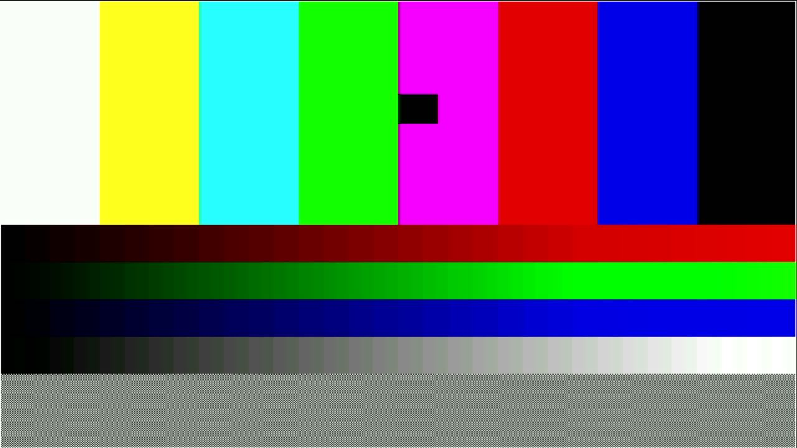

# 002 — First light: DVI on GPIO 32–39

*2026-11-01 · commits `2669474`, `427aaaf`*

The Waveshare RP2350-PiZero routes its mini-HDMI to **GPIO 32–39**. That
rules out the RP2350's HSTX peripheral (GPIO 12–19 only), so DVI goes
through PIO via Luke Wren's PicoDVI. Two independent projects agreed on
the pin map (D0/D1/D2 on 36/34/32, clock on 38). There was one catch: a
PIO block can only see 32 pins at a time, so `pio0` has to be rebased to
GPIO 16–47, and libdvi's 32-bit pin masks quietly drop the high bank. We
patched the masks to 64 bits.

The test pattern checks each risk directly:
- **Colour bars** check lane order. Swapped pins would swap colours.
- **Ramps** check every channel bit.
- **A 1-pixel checkerboard** checks that the grabber samples
  pixel-exactly.
- **A white border** checks that nothing is cropped.

It worked the first time it was captured, but only at 51 fps. A
640×480p60 line is **8 000 cycles** at 252 MHz, and TMDS encoding alone
took 9 224 of them. Packing two 10-bit symbols per FIFO word lets the
RP2350's hardware TMDS encoder pop a pixel pair per read. Together with
an unrolled loop and bus priority for core 1, encode dropped to
**4 392 cycles**, giving a solid 60 fps.
