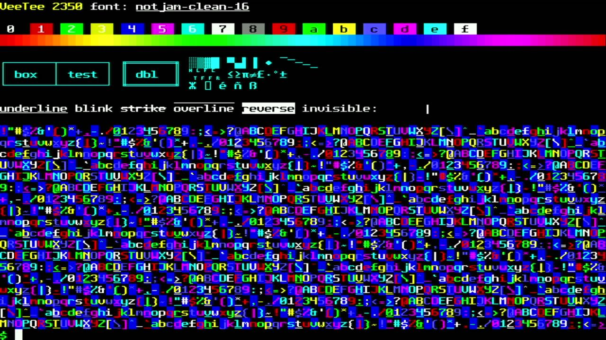

# 003 — Fonts, and the case of the out-lined helper

*2026-11-01 · commits `d782eed`, `4dd6caa`*

The fonts are pixel TTFs: Not Jam Mono in five sizes, plus Arbata
Compact. `tools/ttf2psf.py` rasterizes each one at its native size,
where one design pixel is one screen pixel, and writes **PSF2**, the
Linux console format. That way, existing console fonts load through the
same code. Along the way we found:

- **Not Jam Casual 10 has three glyphs scrambled.** `@` draws a caret,
  `^` an underscore, and `_` an at-sign. We caught it by comparing
  previews with the font's own glyph sheet, and fixed it with a `remap`
  entry in `fonts.toml`.
- **Arbata is proportional.** At a 6-px cell it lost even `%` and `@`.
  An 8×13 cell keeps 2 326 glyphs, including Cyrillic.
- Fonts that lack box drawing, block elements or the DEC line-drawing
  characters get them **synthesized** from their Unicode names.

Then performance. The first renderer cost about 6 300 cycles per line,
more than double what we had left. The disassembly showed why: the core
builds at `-Os`, so GCC had **out-lined a `static inline` helper into
flash**, and every 8-pixel cell went through a long-branch veneer into
XIP. Forcing hot helpers inline, building the renderer at `-O2`, using a
256-entry mask table indexed by the whole glyph byte, and applying
attributes through an `(and, or)` table brought it down to about 3 000.
