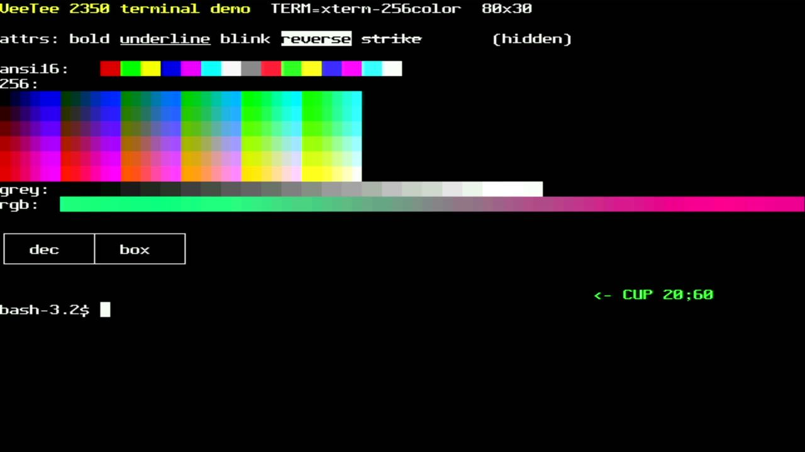
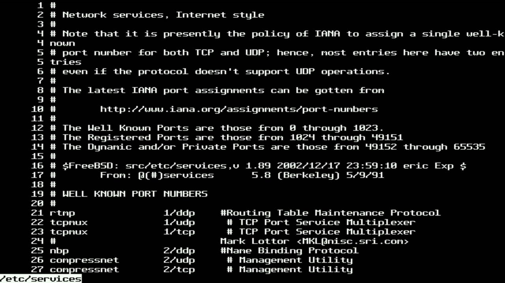

# 004 — It's a terminal

*2026-11-01 · commit `713c392`*

`lib/term` connects libvterm's state callbacks to our grid. Most scrolls
are a rotation of a 64-byte row map, and anything else falls back to a
rectangle move. Erases use the current background colour, like xterm.
The alternate screen is a second grid. Device replies (DA, DSR) go back
to the host.

`tools/hostshell.py` runs bash on the Mac in an 80×30 pty, bridged to
the board's serial port. That's a complete session: `tput` reports
80×30, terminfo's `smacs` draws DEC line graphics, and the 24-bit
gradient comes through (quantized to RGB565 on output).

`less -N` shows a repeated line number on a wrapped line, which looked
like a bug. We captured the raw bytes in a pty: it's `less 668` itself,
including its space-backspace trick at the right margin, which only
works if the terminal wraps exactly like xterm. It does.
