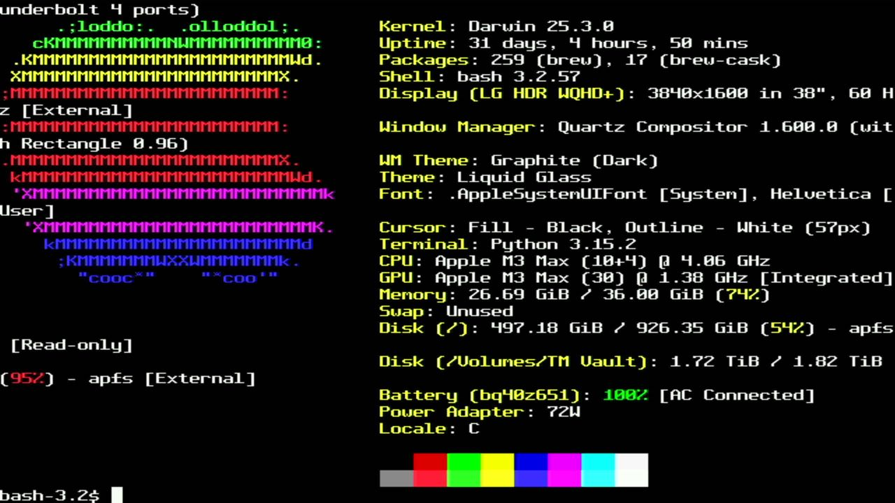

# 005 — Two cores, one picture

*2026-11-01 · commit `d63f688`*

With rendering and encoding both on core 1, a dense screen peaked at
**8 074 of 8 000 cycles**, so a line could occasionally come out as a
glitch. Now core 0 renders into an **8-line ring** from a top-priority
interrupt, and core 1 does nothing but encode. Core 1 rings an RP2350
hardware doorbell after each line to ask for more.

| | Before | After |
|---|---|---|
| core 1 | 7 407 avg / 8 074 max | 4 348, flat |
| core 0 (render) | — | ~3 660 per line |
| starved lines | — | 0 |

One trap: arduino-pico hooks the shared doorbell interrupt even in
single-core mode, and if doorbell 0 fires, its handler freezes the core
forever. The ring uses doorbell 7.

fastfetch's long info lines wrap onto its logo. To check whether that
was correct, `tools/refscreen.py` replays the same output through
**pyte**, an independent emulator. It matches row for row, so it's
fastfetch overflowing 80 columns, not a terminal bug.
