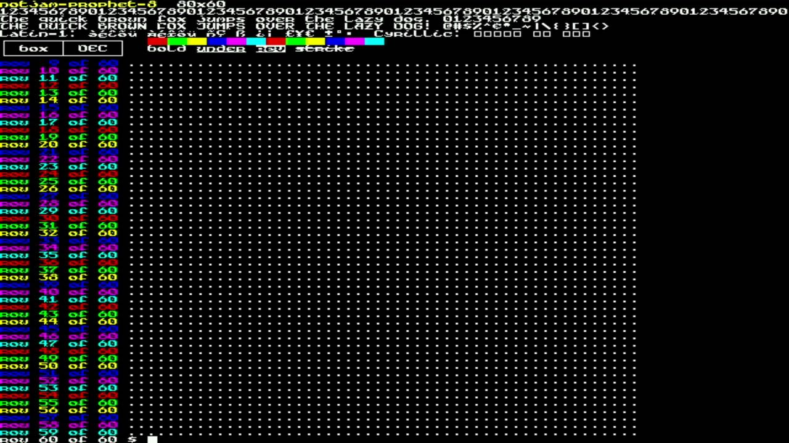
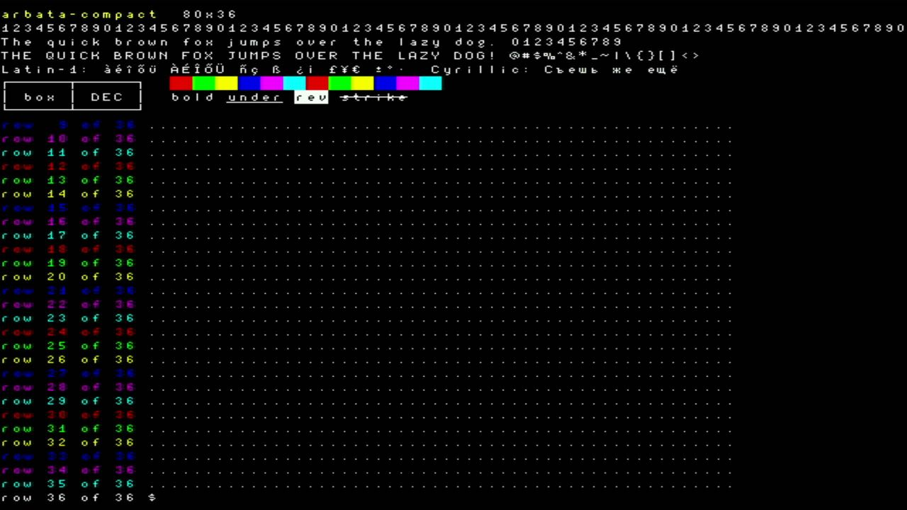
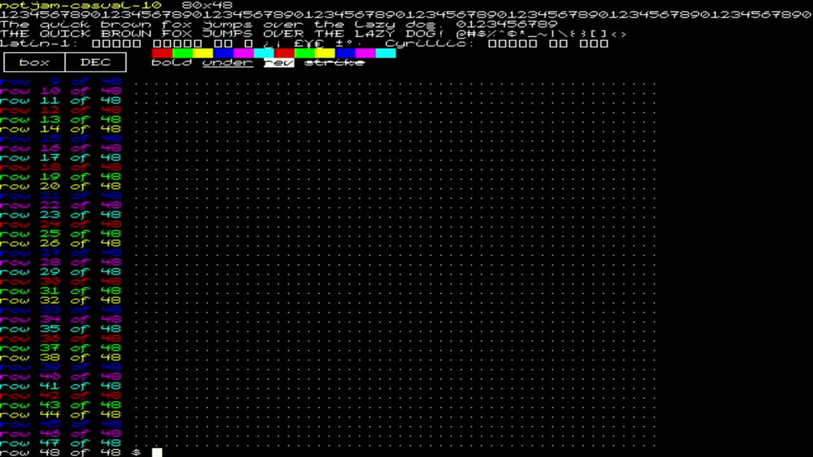
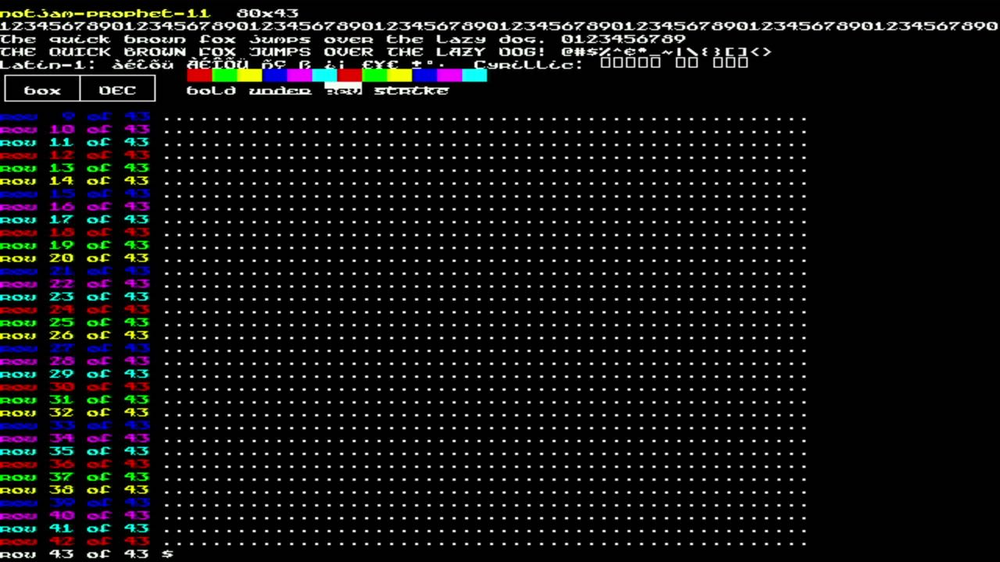

# 006 — Switching fonts live

*2026-11-01 · commit `1523b21`*

| | |
|---|---|
|  |  |
|  |  |

The terminal implements xterm's **OSC 50** ("set font") for its built-in
fonts: switch by name, step with `#+` / `#-`, or query with `?`. A new
font means a new grid size (80×30 up to 80×60), so both screens are
rebuilt and the terminal is fully reset. `tools/setfont` then asks the
terminal for its new size the way `resize(1)` does (cursor to 999;999,
then a position report) and runs `stty`, so programs get SIGWINCH.

In the captures: Casual 10's fixed `@ ^ _` are correct on hardware,
Arbata draws Cyrillic, and fonts without accented letters show the
missing-glyph box, as they should.
