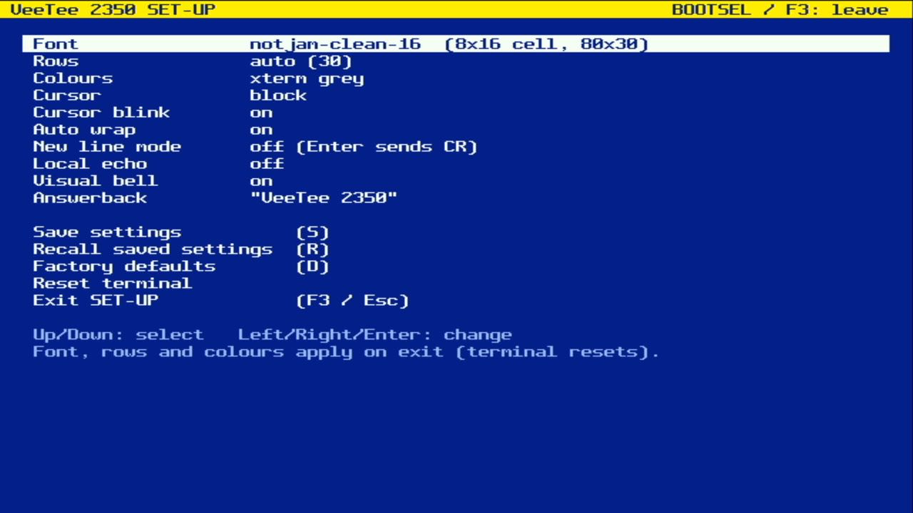
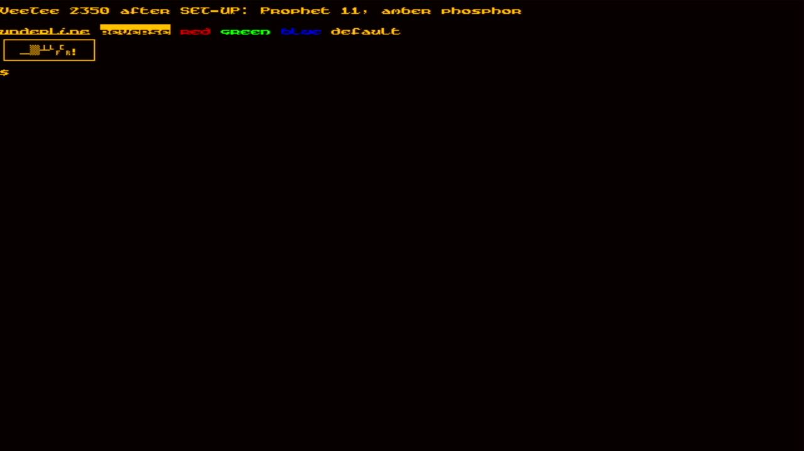
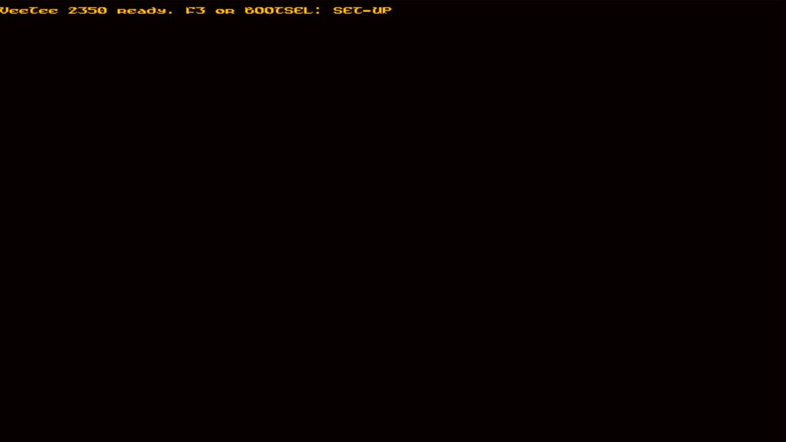

# 008 — SET-UP

*2026-11-01*

Every VT terminal had a SET-UP key. On the VT220 it was F3. Here it's
**F3 on the keyboard port, or the board's BOOTSEL button**. SET-UP draws
into a grid of its own and the renderer switches to it, the same trick
as the alternate screen, so whatever was running underneath is left
untouched and keeps receiving output.

What it configures:
- **font**, which also sets the terminal size (each entry shows the grid
  it gives)
- **rows**: auto, or a classic 24/25, letterboxed
- **colours**: xterm grey, green/amber/white phosphor, or paper
- **cursor** shape and blink
- **auto-wrap**, **new-line mode**, **local echo**, **visual bell**
- the **answerback** message, which is the reply to ENQ

Changing the font, row count or colours resets the terminal, as you
said it may. The other settings are applied by feeding the terminal the
same escape sequences a host would send (DECAWM, LNM, DECSCUSR), so
libvterm stays the only owner of terminal state.

**Saving** writes a CRC-sealed record to the last 4 KB sector of flash.
Flash goes away while it's being written. Thanks to entry 007, core 1
provably never runs from flash, so the picture survives with only a few
filler lines. Here is the board after a reboot, coming straight back up
in the saved font and colours:

Two bugs turned up on the way:
- **Left/Right didn't work on five-entry lists.** `cycle()` computed
  `(unsigned)-1 % 5`, which is 0 because 2³²−1 happens to be divisible
  by 5. A unit test caught it before the hardware did.
- **Uploading broke once there were two serial ports.** PlatformIO sent
  its reset "touch" to the keyboard port, which ignores it.
  `upload_port = /dev/cu.usbmodem*1` pins it to the line port.

The whole session is scripted and repeatable with `tools/sendkeys.py`,
which sends timed keystrokes and line data to the two ports.
