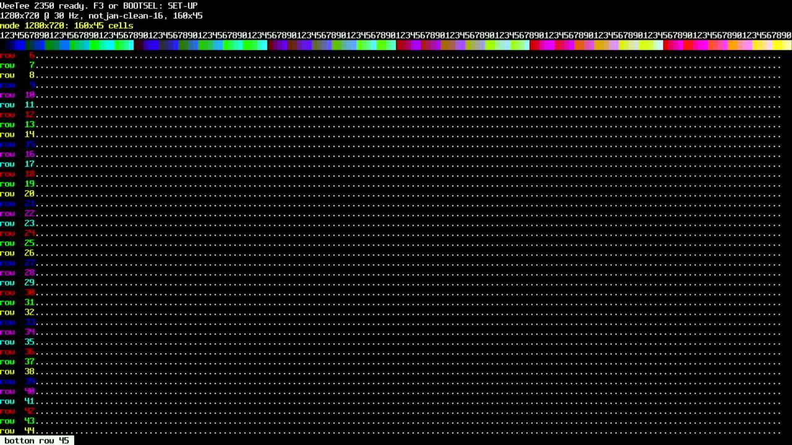
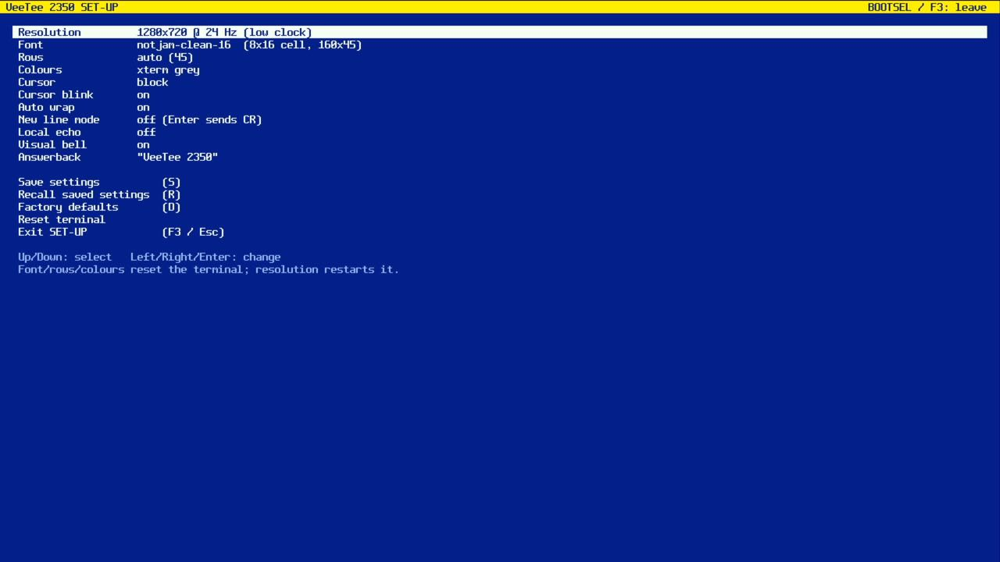
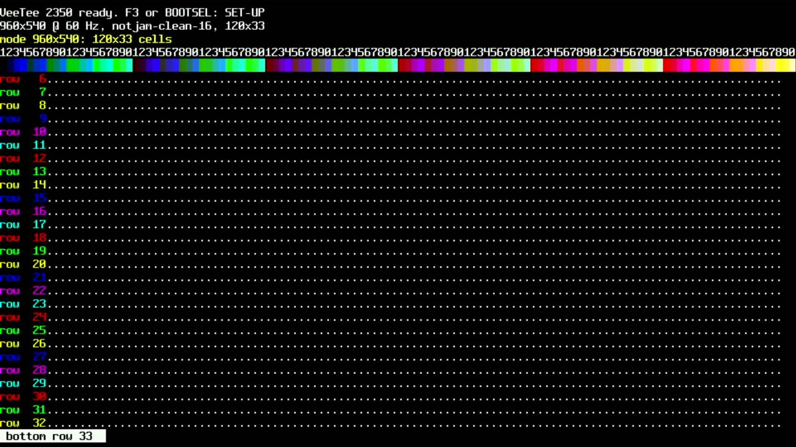
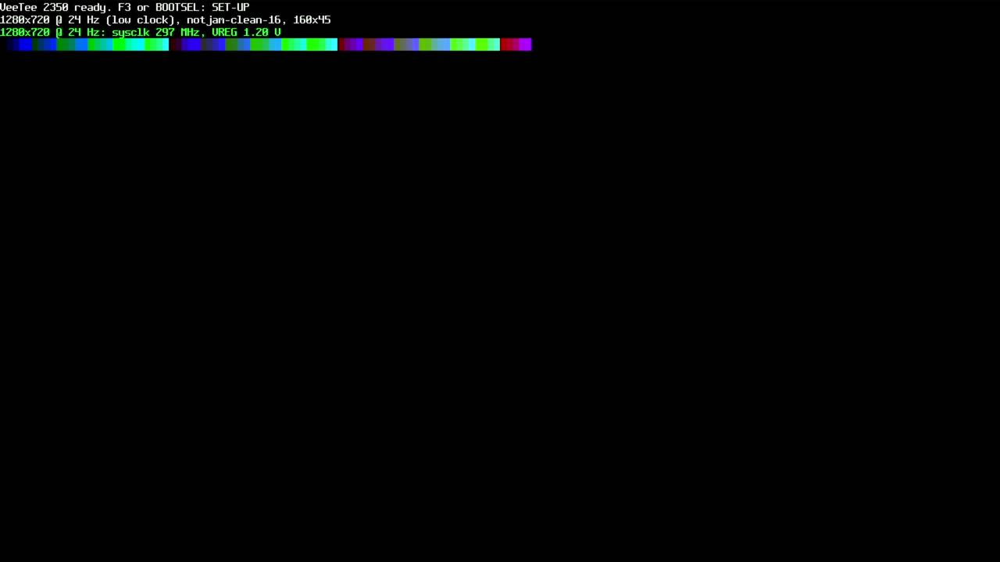

# 009 — Six resolutions, two lurking bugs

*2026-11-02*

SET-UP now has a **Resolution** item. Following PicoDVI's terminal app,
each mode runs the system clock at its TMDS bit clock: 640×480 (252
MHz), 720×480 (270), 800×480 (295), 960×540 (372), 1280×720 @ 30 (372),
and, because you said 24 fps is plenty, **1280×720 @ 24 at only
297 MHz**. That's the same 720p frame with a slower pixel clock: the
same cycles per line, much less overclock.

Video and render now work at any size, and the line ring is sized for
1280 px. A resolution change saves and reboots. The cycles-per-line
budget grows with the line length, so every mode fits with full-colour
encoding: Wren's 1-bpp trick wasn't needed.

## Bug 1: a 32-byte overrun, only at 720 px

At 720×480, opening SET-UP crashed the board. A small HardFault handler
that writes PC and registers into watchdog scratch registers (they
survive the reset) pinned it to the renderer's glyph fetch, reading a
cell whose glyph index was 0xFD00. The cell sat in the SET-UP grid,
which was the first heap block after libdvi's TMDS buffers.

The unrolled TMDS encode loop writes 16 words per iteration. At 640 px
a lane is 320 words, a multiple of 16. **At 720 px it's 360**, so the
last lane overran its malloc'd buffer by 32 bytes on every scanline.
That corrupted whatever the heap handed out next, and that was only
ever the SET-UP grid. The fix is 64 bytes of slack per buffer
(PicoDVI `PATCHES.md` #5).

## Bug 2: the flash clock while the system clock changes

960×540 then crashed *during boot*, inside the SDK's
`clock_configure`. `set_sys_clock_khz()` runs from flash and briefly
parks the system clock on the 48 MHz USB PLL. At that speed, the
sample delay meant for 372 MHz reads every instruction fetch too late.
A `pizero-flashprobe` build measured which delays actually work at each
clock (it re-reads the firmware image uncached at every setting). The
fix uses a transition timing that's valid all the way through the
switch.

## Recovering on its own

You asked for it, and it paid off immediately: after **two crashes in a
row** (watchdog timeouts), the board boots on **factory defaults** and
says so, without touching the saved settings. During this session it
brought the board back from both bugs without anyone touching the
hardware.

