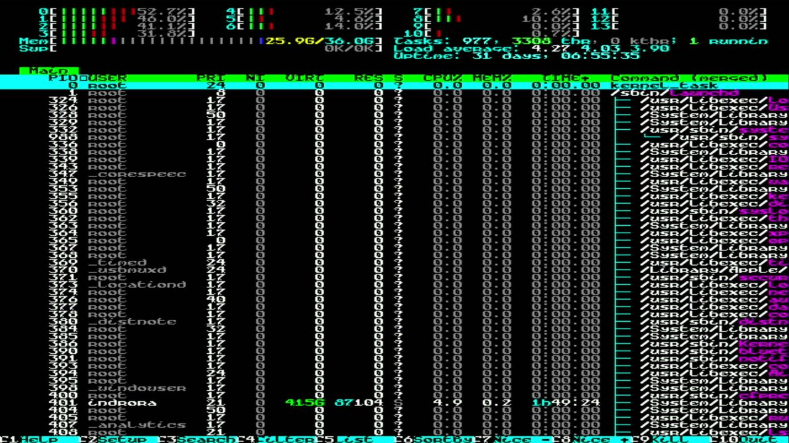
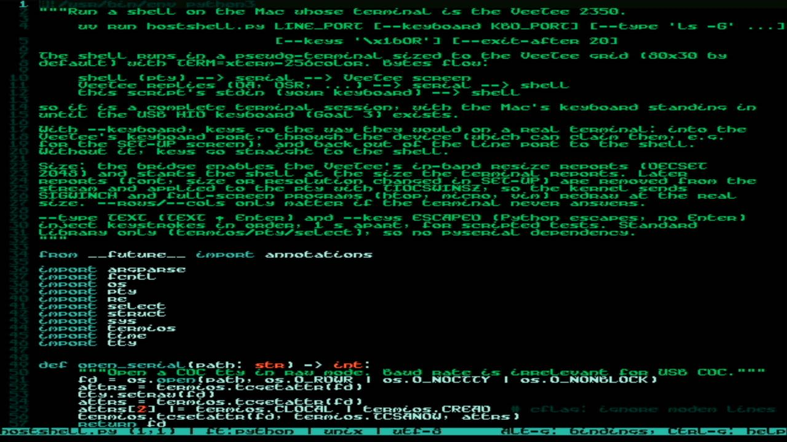
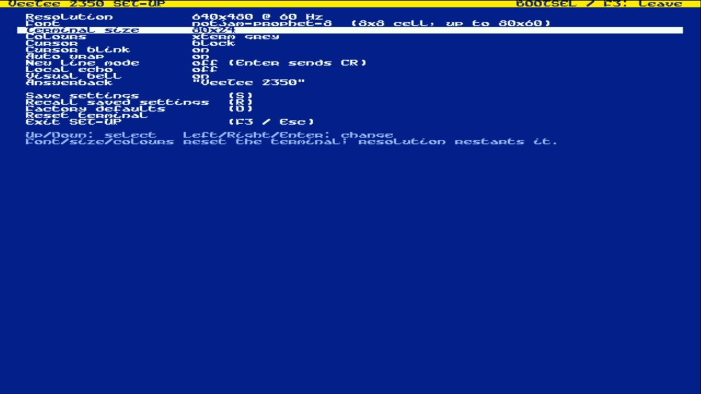
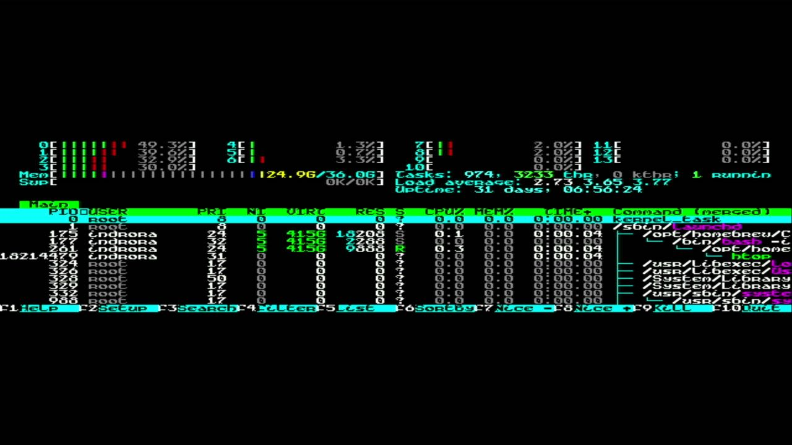

# 010 — Knowing its own size

*2026-11-02*

**The bug you hit:** htop and micro only used part of the screen, worse
with 30+ rows. The terminal drew everything correctly. The *host* simply
didn't know the size. `hostshell.py` always told the pty 80×30, and a
font change in SET-UP never told the host anything.

**The fix has three parts:**
1. **The terminal answers size questions**: xterm's window ops
   `CSI 18 t` (characters), `14 t` (pixels) and `16 t` (cell size).
2. **It announces changes.** **DECSET 2048** is the in-band resize
   notification used by contour, kitty and foot. Once a host enables
   it, the terminal sends `CSI 48 ; rows ; cols ; height ; width t`
   straight away and after every font, size or resolution change.
   libvterm silently dropped unknown DEC modes, so a small, documented
   patch now routes them (and their DECRQM queries) to our fallback.
3. **The bridge listens.** `hostshell.py` enables 2048, starts the
   shell at the real size, strips later reports out of the byte stream,
   and applies them with `TIOCSWINSZ`. The kernel's SIGWINCH does the
   rest.

## Terminal size

SET-UP's *Rows* became **Terminal size**: full screen, or a classic
fixed size (80×24, 80×25, 80×43, 80×50, 132×24, 132×43). Fixed sizes
are letterboxed in both directions, and anything too big for the
current font and resolution is clamped, with SET-UP saying so. 132
columns need the 1280-wide modes.

| | |
|---|---|
|  |  |

Settings are now record version 3, so a board with older saved
settings starts on defaults once.
