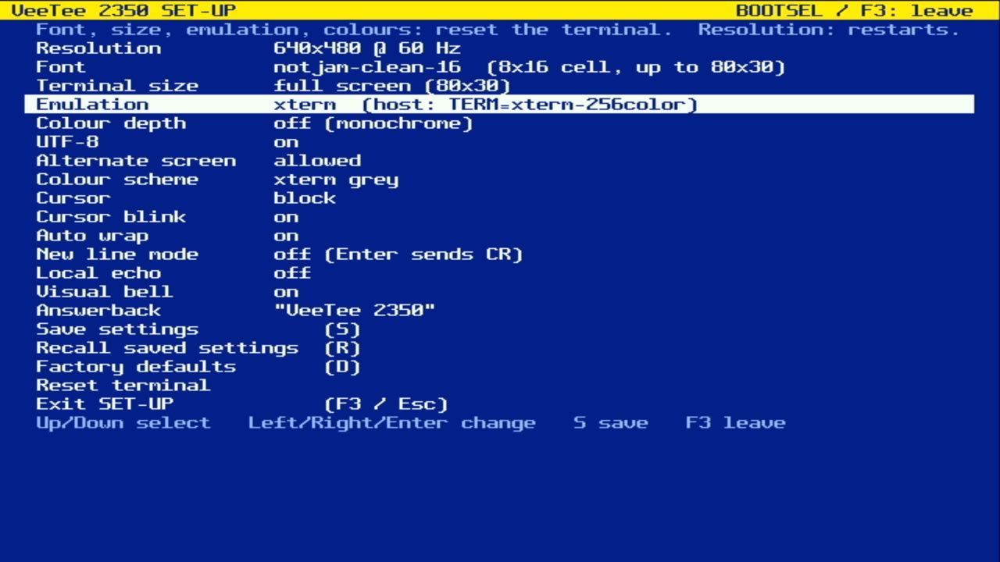
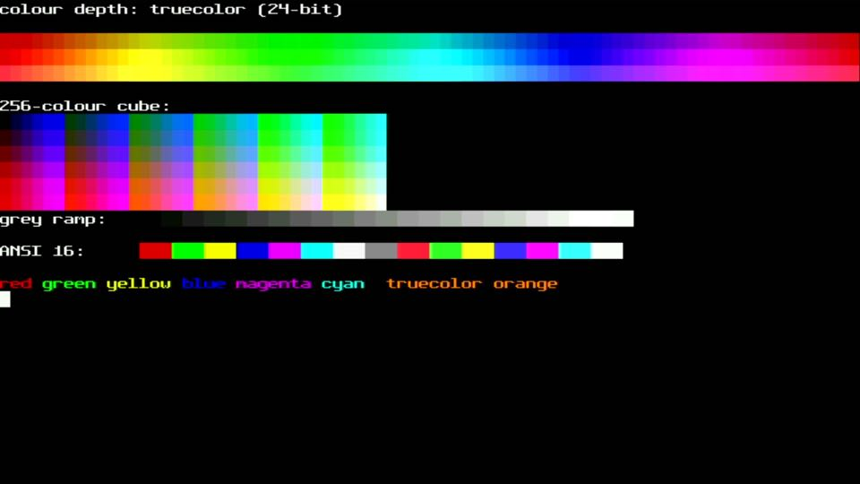
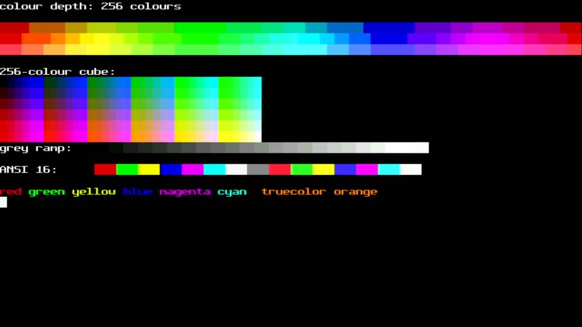
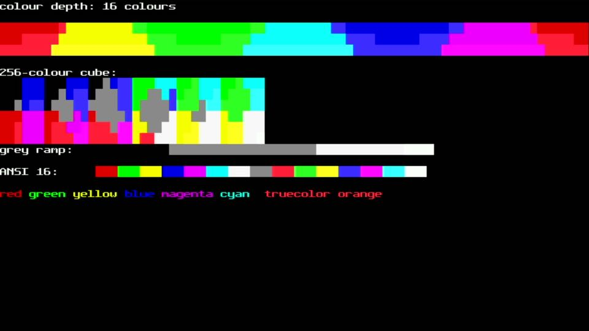
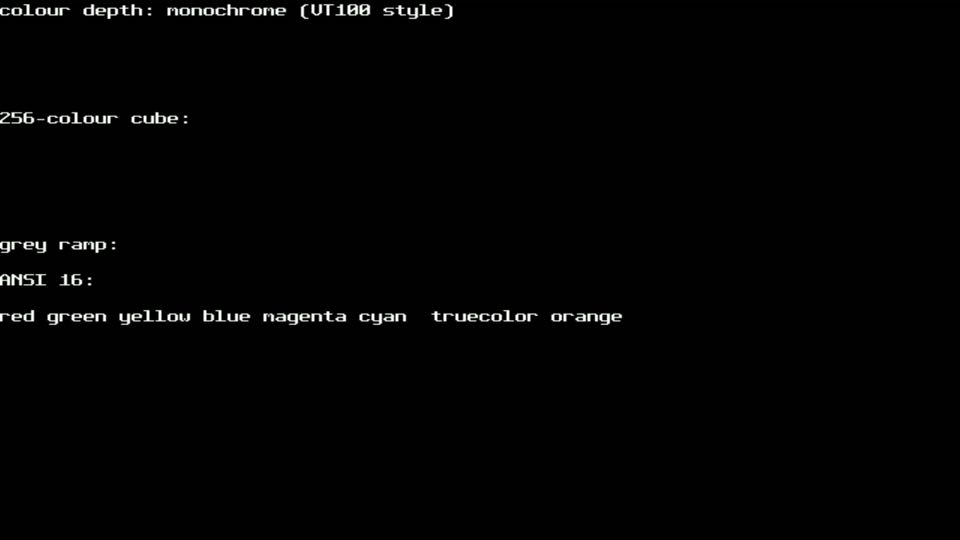

# 011 — Emulation levels

*2026-11-02*

SET-UP can now make the VeeTee behave like different generations of
terminal:

| Level | Answers DA1 with | Colour | UTF-8 | Alt screen | Host `TERM` |
|---|---|---|---|---|---|
| VT100 | `?1;2c` (VT100 with AVO) | off | off | off | `vt100` |
| VT220 | `?62;6;22c` | off | off | off | `vt220` |
| VT340 | `?63;6;22c` | 16 | off | off | `vt340` |
| xterm | `?64;6;22c` (+ DA2 `>41;390;0c`) | 24-bit | on | on | `xterm-256color` |

Choosing a level loads its defaults, and each feature can then be
overridden on its own. We only claim attributes we implement: no `1`
(132 columns, which depends on the resolution), and no `4` (Sixel)
until phase E. libvterm hard-coded its DA replies, so a second small
patch lets the embedder answer them.

## Colour depth

The same test page at each depth. Colours are reduced the way xterm
itself downgrades truecolor: nearest of the 16 ANSI colours, or nearest
of the 256 (the 6×6×6 cube or the grey ramp, whichever is closer).
Monochrome ignores SGR colours entirely, like a real VT100.

| | |
|---|---|
|  |  |
|  |  |

## 8-bit mode

With UTF-8 off, bytes 0x80–0x9F are C1 controls (0x9B is CSI) and
0xA0–0xFF are Latin-1. libvterm only implements three 94-character
sets, so this is done in front of it: C1 bytes become their 7-bit
`ESC` forms and Latin-1 bytes become UTF-8. A real VT220 uses DEC
Supplemental Graphics, which differs from Latin-1 in a few positions.

## Alternate screen off

Turning the alternate screen off works like xterm's titeInhibit:
full-screen programs draw on the main screen and their output stays
there afterwards. The first attempt let libvterm "switch" anyway, and it
then erased what it thought was the alternate screen but was really our
primary. A host test caught that, and the fix uses libvterm's own veto:
the callback returns 0.

## One unexplained frame

One capture of SET-UP came back green-tinted and torn. It didn't
happen again in three immediate retries or since. It might be the
grabber; the stats build's starved-line counter will tell us in the
test-suite phase.
