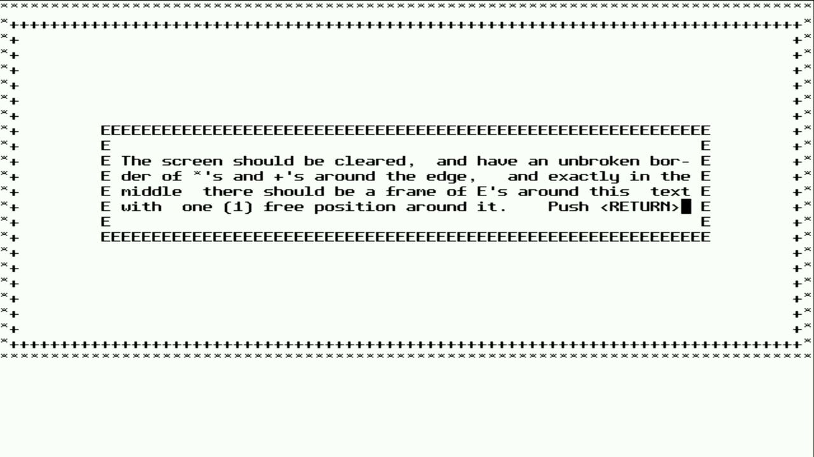
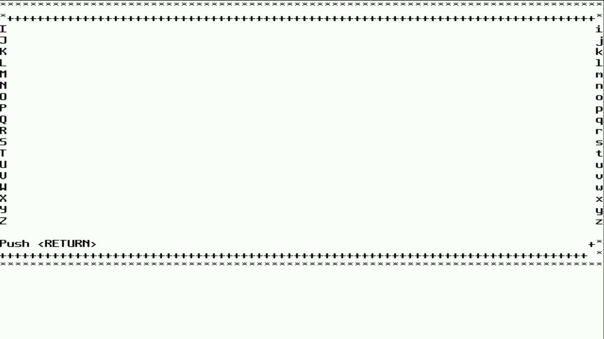
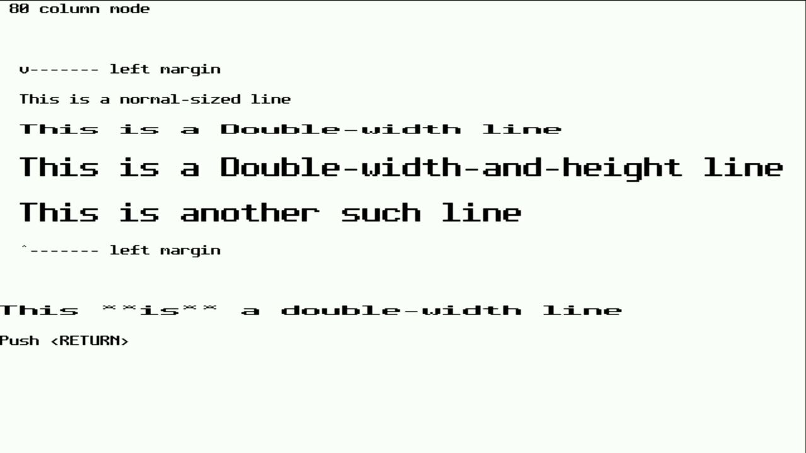
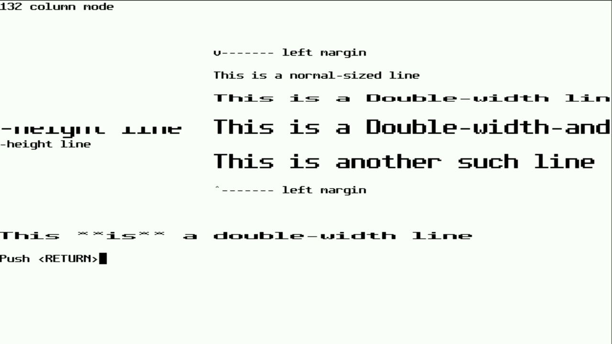
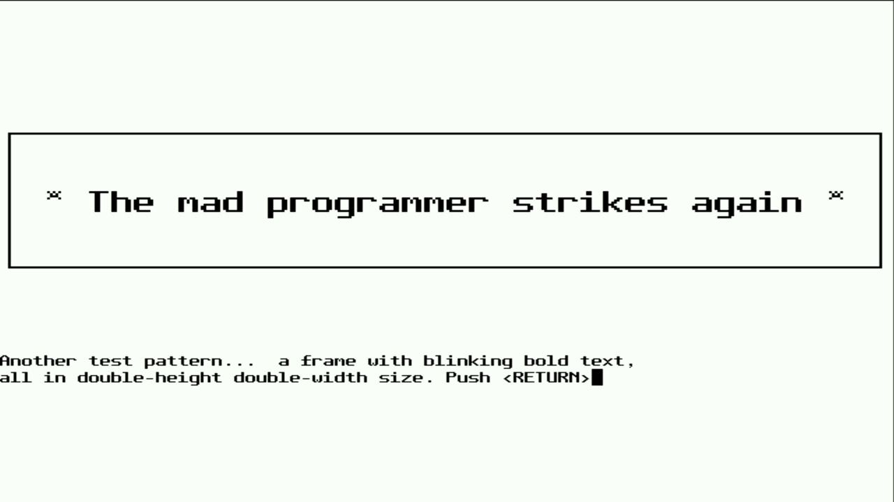
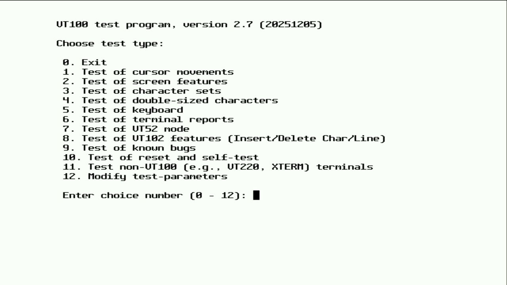

# 012 — Taking the tests

*2026-11-02*

Phase D was about measuring the terminal against other people's
yardsticks instead of our own unit tests. There are two:

- **esctest2** (George Nachman's, maintained by Thomas Dickey alongside
  xterm). It has 567 automated tests that send a sequence and then read
  the screen back with DECRQCRA checksums, so the whole thing runs
  unattended over the line port.
- **vttest**, the classic. Every screen has to be judged by eye, so it
  is driven through the keyboard port and photographed with the grabber.

## esctest2

esctest runs inside `tools/hostshell.py`, which bridges a pty to the
VeeTee's line port, so it sees a real tty with the VeeTee on the other
end. `tools/esc_summary.py` tallies a log per test class and diffs two
runs, which turned 400 failures into a few dozen clusters to fix one at
a time.

| Run | Passed / 567 | What changed |
|---|---|---|
| baseline | 169 (30%) | stock libvterm, no DECRQCRA (so most screen checks failed) |
| run 3 | 366 (65%) | DECRQCRA, DECRQM, DSR variants, OSC colours, REP, XTGETTCAP |
| run 4 | 387 (68%) | VT420 rectangles, DECSCA protection, DECSED/DECSEL |
| run 5 | 382 | SCOSC/SCORC, reverse wrap — but two regressions |
| run 6 | 403 (71%) | reset now clears reverse wrap and the saved cursor's protection |
| run 7 | 407 | DECRQSS for DECSCL, DECSACE, DECSASD, DECSSDT |
| run 8 | 408 (72%) | DECRC with nothing saved restores the default pen |

Most of the work was making libvterm hand things it doesn't know to the
embedder instead of quietly dropping or mis-answering them. That's now
eight small patches, all listed in `lib/libvterm/PATCHES.md`. The
pattern is always the same: unknown modes, DA, CSI with odd
intermediates, DECRQSS settings → the fallback callbacks → `lib/term`
answers them.

Two lessons:

- **DECRQCRA checksums are the foundation.** Until the terminal could
  checksum a rectangle of the screen, esctest couldn't check anything,
  and the baseline was mostly false failures. xterm since patch 334
  checksums erased cells as spaces, so the grid now tracks an
  "erased" bit per cell.
- **Reset is a test of everything else.** Both run-5 regressions were
  state that a feature added and RIS/DECSTR forgot to clear. The last
  DECRQSS failure was the same shape: esctest's between-test reset ends
  with a `?1048l` (restore cursor) that nothing had saved, and libvterm
  restored an all-zero pen, so SGR came back as explicit black-on-black
  RGB. Reset now seeds the saved pen with the default one.

What's left, roughly by size:

- **Window ops** (19): iconify, move, title stack, label reports. There
  is no window.
- **DECCOLM** (132 columns): at 640 px and an 8-pixel font there's no
  room for 132 columns. See below.
- **Xcms colour spaces** in OSC 4/10–19 (`CIEXYZ:` etc.): unsupported.
- **DECBI/DECFI** (back/forward index) and **DECCARA/DECRARA**
  (attributes in a rectangle): not implemented yet.
- A handful of left/right margin (DECLRMM) interactions with BS, CR
  and the cursor keys.

## vttest

`tools/vttest_tour.sh` types menu choices and Returns into vttest on a
timer and asks the capture daemon for a frame on each screen. These are
from menu 1 (cursor movement) and menu 4 (double-sized characters).

Autowrap mixed with control characters, at 80 columns: uppercase down
the left margin, lowercase down the right, exactly as specified.

DECDWL and DECDHL. Each double-height line is two rows, the top half
and the bottom half of the same glyphs scaled ×2.

The same test's 132-column pass, and the one obvious failure. vttest
sets DECCOLM, assumes 132 columns and positions text for them; the
VeeTee stays at 80, so the long lines wrap ("-height line"). The menu 1
autowrap test fails the same way in its 132-column pass.

## Next

DECCOLM is the most visible gap. The plan is to honour it when the
current resolution and font have room (960×540 and both 720p modes
do), and to keep refusing it at 640×480 rather than draw a squashed
font. After that: Sixel (phase E).
