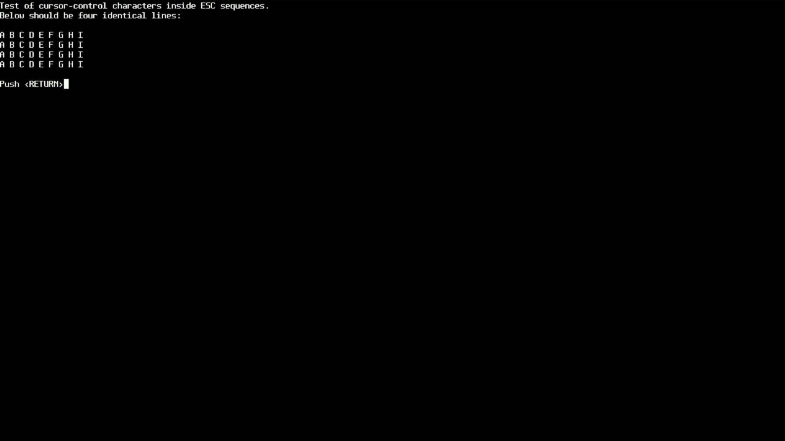
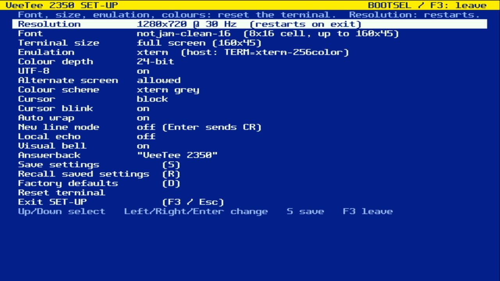
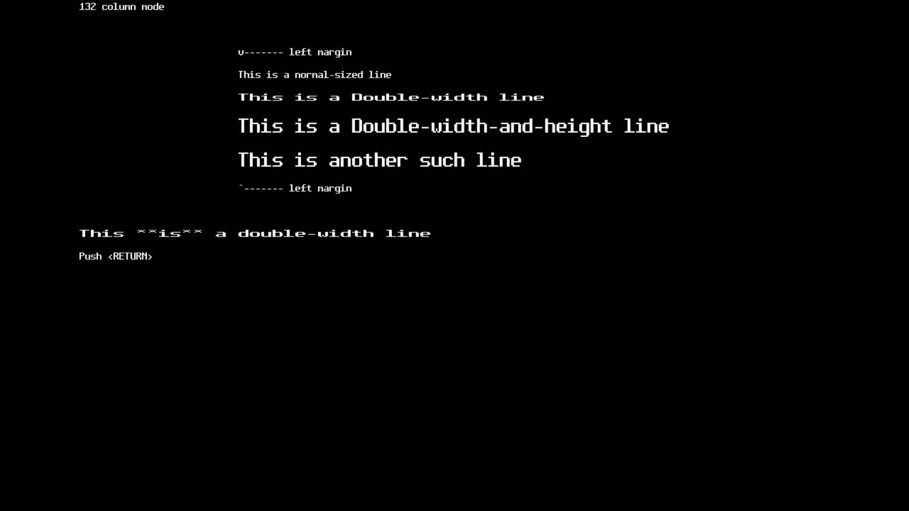

# 013 — 132 columns

*2026-11-02*

DECCOLM was the most visible gap left after the esctest round: vttest
runs most of its screens twice, at 80 and at 132 columns, and every
132-column pass came out wrapped. Now `CSI ? 3 h` really does give you
132 columns, as long as the screen is wide enough for them.

## Where 132 fits

The fonts are 8 pixels wide, so 132 columns need 1056 pixels. That's
only the two 720p modes (1280 px → up to 160 columns). At 640×480,
800×480 and 960×540 the request is ignored, the way xterm ignores it
when 80/132 switching is disallowed, and DECRQM keeps reporting
80-column mode. A 6-pixel font would make it fit at 800×480; maybe
later.

Above: the autowrap test's 132-column pass. The grid is centred on the
screen, so 132 columns sit with 14 columns of border on each side, and
the margin letters line up exactly at columns 1 and 132.

## What "80 columns" means

On a VT100, `?3l` meant 80 columns. Here it means *the width SET-UP
configured*: 80 for the fixed 80×N terminal sizes, the full screen for
"full screen". Otherwise `reset` (whose init string includes `?3l`)
would cut a 160-column screen down to 80. The price is that vttest's
"80-column" screens only look right with a fixed 80×N size:

Each switch does what DEC STD 070 says: clear the screen (unless
DECNCSM, mode 95, is set), home the cursor, and reset the top/bottom
and left/right margins. xterm's mode 40 ("allow 80⇄132") is supported,
but on by default, since a real VT never asked. With DECSET 2048 on, the
host also gets a size report, so `hostshell.py` resizes the pty and
full-screen programs follow along.

## Synchronous, unlike a font switch

Font switches are deferred until libvterm has finished the chunk it's
parsing, because they rebuild everything. DECCOLM can't wait: vttest
sends `?3h` and starts drawing in the very same write. So the switch
happens right inside libvterm's CSI callback. That's safe because
`vterm_set_size()` only touches the state layer (bounds, tab stops,
per-row line info), never the parser that's calling us.

## A bug in passing

While reading libvterm's resize path, a real one turned up. `on_resize()`
is meant to reallocate the per-row line info (the DECDWL/DECDHL flags)
when the row count changes. It compared `rows != state->rows` *after*
assigning `state->rows = rows`, so it never did, and that code only ran
without a resize callback anyway. Growing the screen (a smaller font,
or a bigger terminal size in SET-UP) then wrote past the end of both
arrays. That's libvterm patch 9.

## Numbers

esctest at 1280×720 (160×45): 409 / 567, with `test_DECSET_DECCOLM` now
passing and nothing lost to the bigger screen. Some frames from the
720p @ 30 Hz runs came back black. The board kept running (the next
captures were fine), so it looks like the grabber now and then drops a
frame of PicoDVI's nonstandard half-rate 720p. Not yet investigated.
