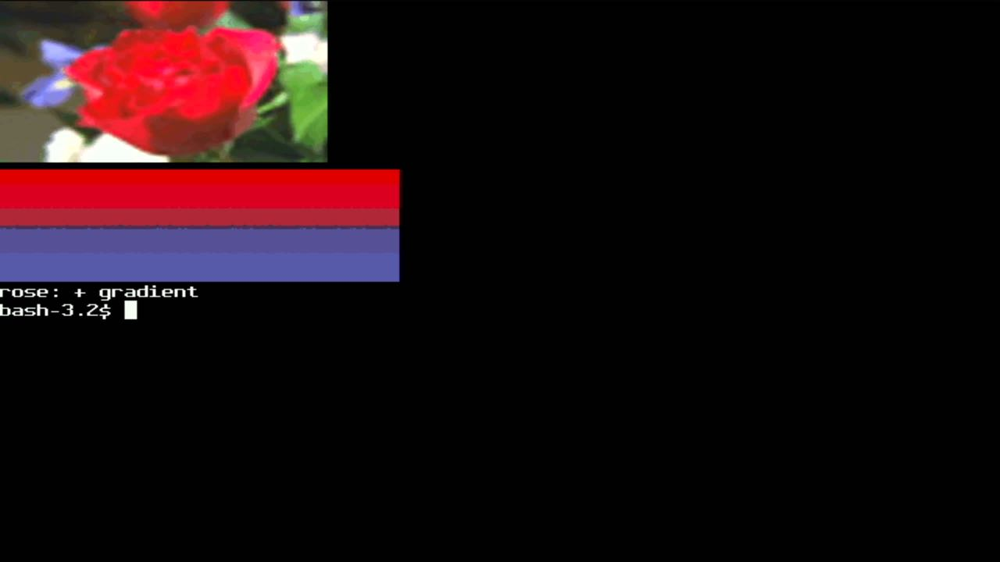
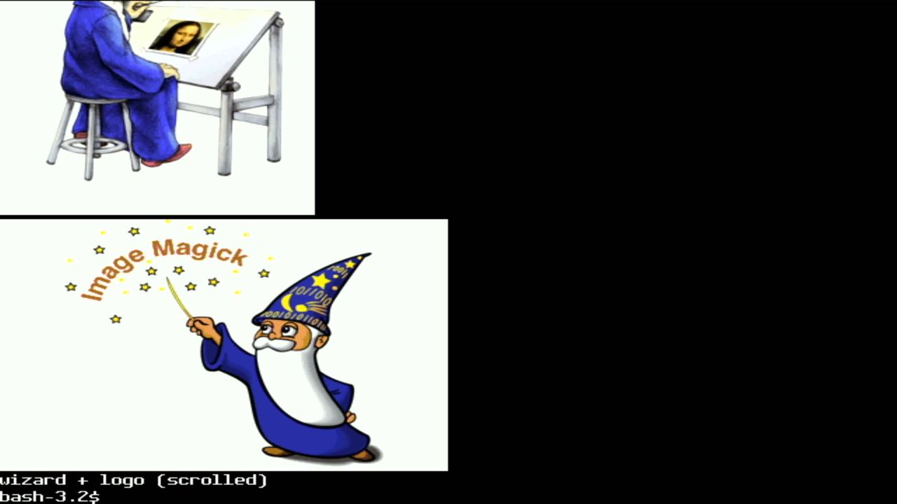
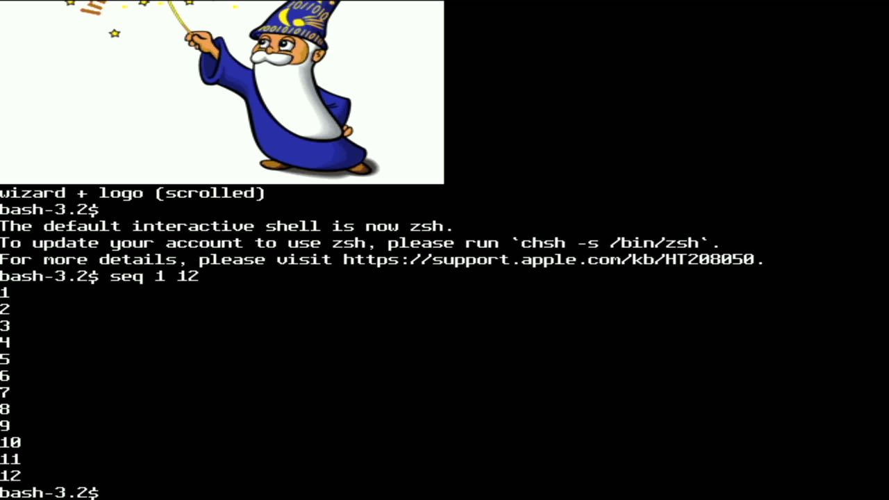
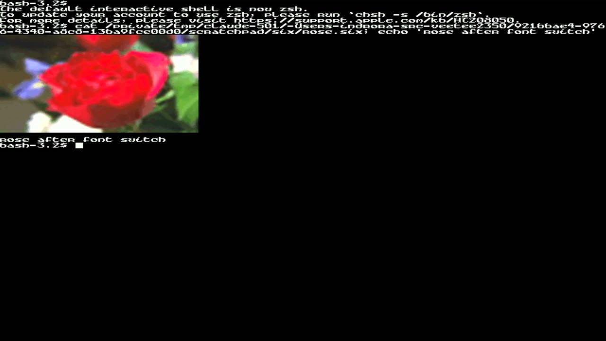
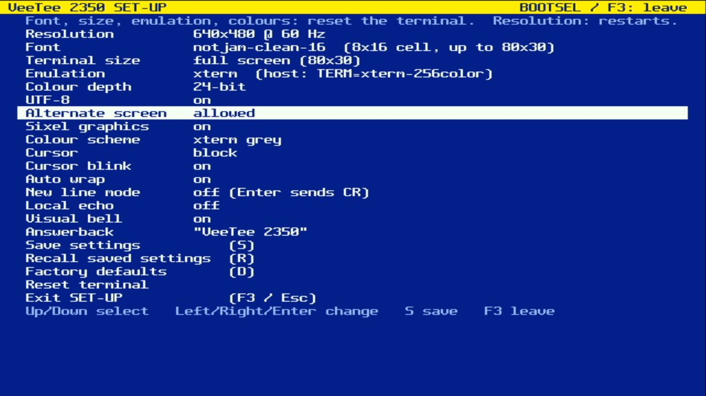

# 014 — Sixel

*2026-11-02*

The VeeTee draws DEC Sixel graphics now. `magick rose: sixel:-` on the
host, and a rose shows up on the HDMI output.

## Pictures as characters

The big decision was where pixels live. A full 640×480 frame at a byte
per pixel is 300 KB, most of the RAM there is. And the terminal already
has a structure that knows how to scroll, erase, switch screens and get
overwritten: the cell grid.

So every character cell an image touches becomes a **graphic cell**.
Its glyph index, normally a font glyph, now names a *tile*: one font cell
of 8-bit pixels (128 bytes for 8×16) in a pool on the heap. The renderer
has one extra test in its hot loop, using the same load it already does
for the attribute bits, and draws a graphic cell with eight palette
lookups per scanline instead of a glyph row. Everything else comes free:

- scrolling moves the row map, so pictures scroll with the text;
- ED, EL, ECH and DECERA erase them; DECCRA copies them;
- typing over a picture replaces those cells with text;
- the alternate screen keeps its own.

Tiles are never freed explicitly. When the pool runs dry, a mark-sweep
over both screens keeps the tiles some cell still points at and
recycles the rest. An image drawn over an older one reuses its tiles in
place, so animations don't eat the pool.

## Colour

Sixel images define up to 256 colour registers each. Tile pixels index a
shared 256-entry RGB565 palette instead, and registers map onto it *by
value*. Redefining register 1 in a new image never recolours an old one
still on screen, and two images that both use pure red share a slot. Up
to 255 distinct colours can be on screen at once (the 256th index means
"transparent: show the cell's background"); past that, new colours take
the nearest slot. The palette empties again once no graphic cell is
left.

## Memory

The pool takes what the heap can spare, up to 256 KB. At 640×480 that's
the full 2048 cells, 85% of the screen; the boot banner says so. It's
malloc'd *after* the DVI buffers and grids, so it's the last big thing
on the heap. That matters because a font switch or DECCOLM rebuilds the
grids: the pool is handed back first and taken again afterwards, sized
to whatever is left. The first hardware test found a wrinkle. The new
font's glyphs get loaded while the old pool is still held, and they land
in the middle of its old space, so the "free" total isn't one block. The
allocation now steps down until a block that size exists.

## The decoder

`lib/sixel` is a 210-line streaming state machine with no allocation: it
never holds an image, it hands each six-pixel column to a sink as it
parses. libvterm delivers DCS bodies in fragments, so an image can be
any size and arrive in any number of USB packets.

Behaviour follows xterm: the image's top-left is the cursor cell; it
scrolls the screen if it runs off the bottom (unless DECSDM, mode 80);
afterwards the cursor sits at the image's left column on the next line
(or to its right, with mode 8452). Mode 1070 (private colour registers,
on by default) starts every image from the VT340 palette. DA1 now
answers `?64;4;6;22c` (the `4` is Sixel), and XTSMGRAPHICS reports 256
registers and the pixel geometry, which notcurses and chafa check.

SET-UP gains "Sixel graphics", on by default at the VT340 and xterm
levels. (The settings version moved to 5, so saved settings reset once.)

## Not yet

- Unpainted pixels are always transparent; P2=0 should paint them in
  colour 0. In practice that's the background anyway.
- Pixel aspect ratio is ignored (1:1).
- Graphics on double-width lines aren't drawn.
- At 1280×720 @ 24 the grabber showed no signal, and stayed that way
  even after going back to 640×480, with the firmware from *before*
  Sixel too. The board kept answering over USB the whole time, so it
  looks like the ShadowCast wedges on that mode. 720p Sixel is
  therefore untested on screen; the pool and geometry replies check out
  over USB.
