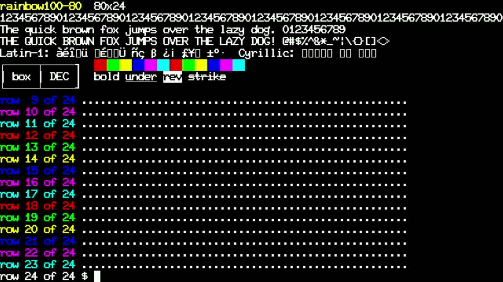
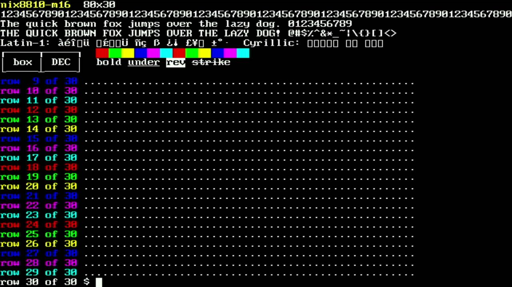
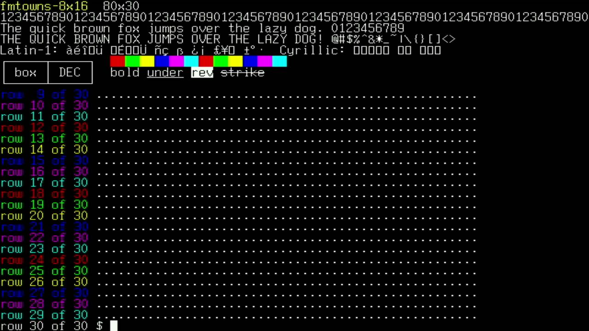
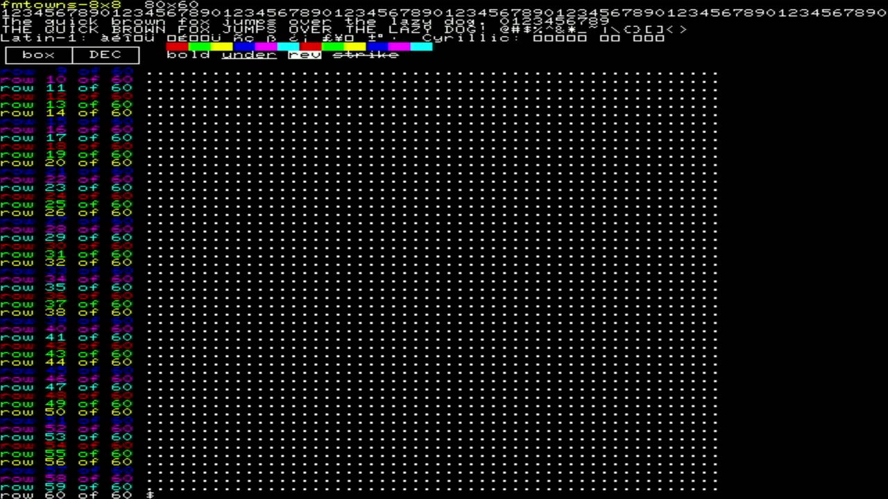

# 015 — Old-school fonts, and an SD card slot

*2026-11-02*

Four fonts from VileR's [Ultimate Oldschool PC Font Pack](https://int10h.org/oldschool-pc-fonts/)
are now built in (CC BY-SA 4.0; converted to PSF2 by `tools/ttf2psf.py`,
credited in `fonts_builtin.c`):

| Font | Cell | Screen at 640x480 |
|---|---|---|
| `rainbow100-80` (DEC Rainbow 100, 80-column) | 8x20 | 80x24 |
| `nix8810-m16` (Nixdorf 8810 M16) | 8x16 | 80x30 |
| `fmtowns-8x16` (Fujitsu FM Towns) | 8x16 | 80x30 |
| `fmtowns-8x8` | 8x8 | 80x60 |

The Rainbow one needed a little thought. Its TTF is a 10x10 design
whose pixels are twice as tall as they are wide (the original doubled
its scan lines), so FreeType at 24 ppem gives a 10x20 cell. A 10-pixel
cell would knock the renderer off its 8-pixel fast path. But every text
glyph sits in the left eight columns (the last two are spacing), so the
cell is simply cropped to 8x20. The only casualties were the box and
block glyphs that reached across all ten columns to join their
neighbours; the converter drops anything that doesn't fit and redraws
those at 8 px with its own box synthesizer. The result is 640/8 x
480/20 = **80x24, a real VT100 screen.**

## The SD card slot

The PiZero's TF slot is wired for 4-bit SDIO, but its CLK, CMD and DAT0
land on GP30, GP31 and GP40, which happen to be SPI1's SCK, TX and RX
on the RP2350B. So the card runs in plain SPI mode on hardware SPI1, with
DAT3 (GP43) as chip select. No PIO block is used (pio0 drives the HDMI
output; another is earmarked for a USB keyboard host port), and SPI
doesn't care that the system clock changes with the video mode.

`lib/hal/storage.h` is a small C file API (mount, open, read, write,
list, mkdir) over arduino-pico's bundled SdFat, which is C++, so the
implementation is a shim in `src/storage_sd.cpp`, the same arrangement
as the USB ports. Opening SET-UP probes the card and shows the result in
the title row. With no card, that's "SD: no card / not FAT". The card
itself comes next: fonts and colour schemes loaded from it, screenshots
and a "printer" written to it.

(An aside: the grabber spent a while showing no signal after a 720p @
24 Hz test, with the board perfectly healthy over USB. A replug and the
Genki app brought the picture back.)
