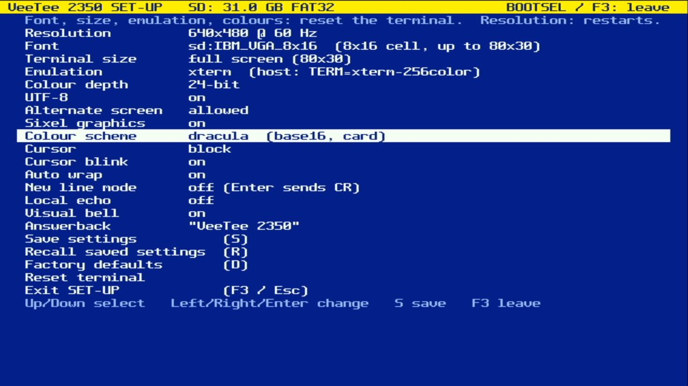
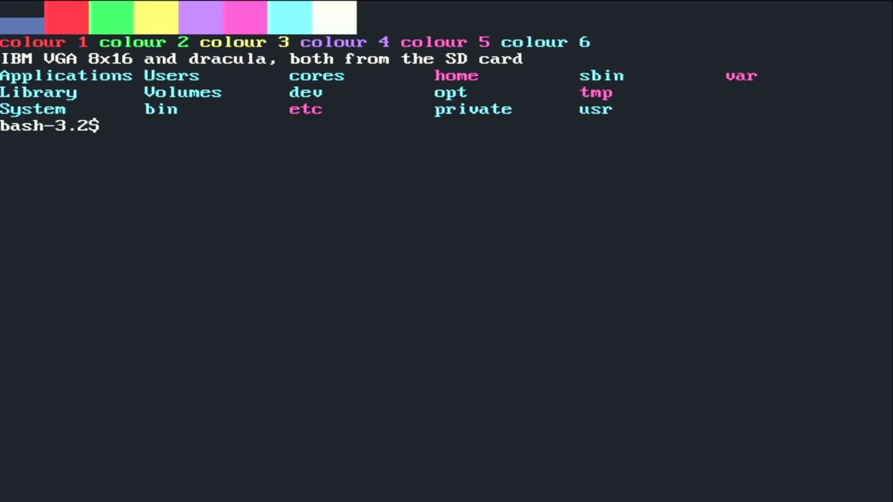
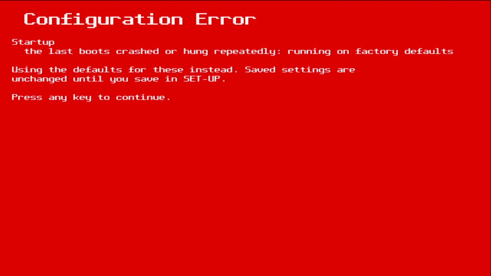

# 016 — Fonts and colour schemes from the SD card

*2026-11-02*

The SD card now holds fonts and colour schemes:

    /fonts/<name>.psf       PSF2 fonts
    /schemes/<name>.yaml    base16 colour schemes

`tools/sd_card.py` builds a ready-to-copy `sd/` folder:

- **64 fonts** converted from VileR's Ultimate Oldschool PC Font Pack
  (CC BY-SA 4.0): every 8-pixel-wide font that converts cleanly, plus
  the 9-pixel VGA-style ones cropped to 8 (their ninth column is only
  spacing or line-graphics extension). IBM VGA/EGA/CGA/MDA, Amstrad,
  Tandy, Toshiba, Compaq and friends come first.
- **64 base16 schemes** from tinted-theming (MIT), copied as-is, with
  the well-known ones first.

SET-UP's Font and Colour scheme items run through the built-ins and
then the card's. The choice is saved as `sd:Name` / the scheme name.

## base16

A base16 scheme is sixteen colours with fixed roles. The terminal uses
base16-shell's mapping, the one every base16 terminal theme uses:
background base00, foreground base05, ANSI red/green/yellow/blue/
magenta/cyan from the accents, and the bright row from the lighter
greys. The firmware reads both generations of the file format with a
small line parser (lib/setup/base16.c), no YAML library. Before shipping the card, every
one of the 360 schemes in the repository was run through that exact C
parser on the host: all 360 parse.

## 64, and why it was slow

The first card had all 241 fonts and 360 schemes, and opening SET-UP
reset the board: the watchdog fired. Two things were wrong.

1. **Quadratic listing.** arduino-pico's SD wrapper implements
   `openNextFile()` by stepping a directory iterator and then reopening
   the entry *by path*, and every path lookup searches the directory
   from the top. A few hundred files, twice that with the `._` files
   macOS leaves on FAT cards, was tens of thousands of directory
   reads. The storage layer now uses SdFat directly, where
   `FsFile::openNext()` opens the entry where the iterator stands. The
   PSF header (for the cell size) is read through that same open file.
2. **Too many anyway.** Nobody scrolls through 600 entries with the
   arrow keys. The card lists are capped at the first 64 fonts and 64
   schemes, caveat emptor, and the tool writes exactly 64 of each.

Scanning feeds the watchdog per entry and reports its progress on
SET-UP's message line ("Reading /fonts: 32"). The result is cached in
`/veetee/catalog.bin` under a fingerprint of both folders (FNV-1a over
names and sizes), so after the first time, opening SET-UP says "Card:
64 fonts, 64 schemes (from cache)".

## Configuration Error

When a saved card font or scheme can't be loaded (no card, a damaged
file, not enough memory), or the crash guard falls back to factory
defaults, the terminal takes over the screen: white on red, a
double-height title, each problem with its file and reason. The
default is used instead, for this session only, so forgetting the card
one day doesn't wipe your settings; host output waits until a key is
pressed. (The screenshot is the crash-guard case, from the watchdog
episode above.)

## Video first

Boot now starts on a built-in font, brings the video up, and only then
applies the saved settings, which may read the card. A missing card
can't hold up the first picture, and its error has a screen to show
on.

There was a detour on the way. With the card pulled, the grabber
showed no signal, and for a while that looked like SD access before
`video_init` killing the HDMI output. The stats build said otherwise:
60 frames a second, nothing starved. The ShadowCast was wedged, and it
stays wedged across board reboots until it's replugged. Video-first
stayed because it's the right order anyway.
