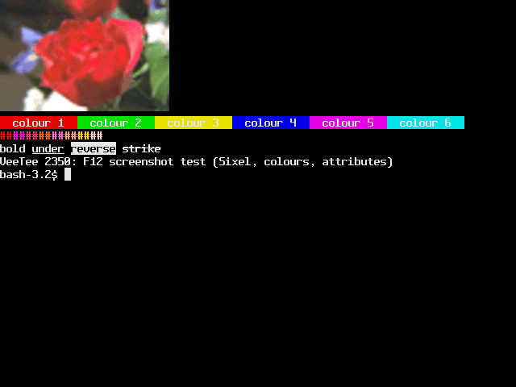
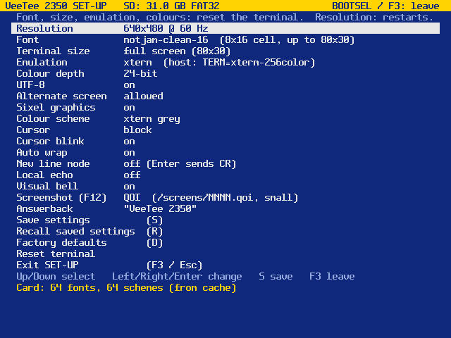

# 017 — Screenshots, by the terminal itself

*2026-11-02*

Every picture in this devlog so far came through an HDMI grabber and a
camera-style capture: soft, upscaled, occasionally wedged. These two
are different. The VeeTee took them itself. Press **F12** and the
screen goes to the SD card as `/screens/NNNN.bmp` or `NNNN.qoi`
(SET-UP: "Screenshot (F12)").

## No framebuffer to copy

There is no picture in memory to save: the screen is rendered a
scanline at a time, just in time for the DVI encoder. So a screenshot
asks the renderer for every line again, from the main loop, into a
line buffer, and streams each line to the card. The interrupt-driven
display keeps running meanwhile. What lands in the file is exactly
what goes out over HDMI: border, cursor, Sixel cells, and SET-UP if
it's open.

## Two formats

- **BMP**, 16-bit RGB565, the renderer's own pixel format, top-down.
  Opens anywhere. 614 KB at 640x480.
- **QOI** ("Quite OK Image"), widened to 24-bit by bit replication
  (so 0x1f becomes 0xff and white stays white). Terminal screens are
  mostly long runs of background, which QOI's run op swallows: the
  screen above is **47 KB**, and a plain text screen about 19 KB, 32
  times smaller than the BMP. A whole screen takes under 200 ms.

The reference `qoi.h` wants the whole image in memory (900 KB here),
so `lib/qoi` is a small streaming encoder written from the spec:
begin, feed pixels in order, end.

## Two bugs worth keeping

**A HardFault.** The first F12 rebooted the board; the HardFault
recorder put `pc=0x20000e30` on the next boot banner, inside
`render_scanline`. The renderer stores pixels two words at a time
(STRD/STM), which faults on the Cortex-M33 if the address isn't
word-aligned, and the screenshot's line buffer was a plain `uint16_t`
array with 2-byte alignment. The DVI ring buffers had always been
aligned; this was the first new caller. Now `alignas(8)`.

**A QOI that decoded as nonsense.** The first QOI off the card
decoded to scrambled rows and then a salmon-pink screen. Decoding it by
hand next to the BMP found the first bad pixel at (29, 1): an `INDEX`
op pointing into a slot of QOI's 64-entry colour cache that the
decoder had never filled. The decoder starts every slot as (0,0,0,**0**),
transparent black; the encoder only remembered RGB, so an empty slot
"matched" opaque black. Once the decoder took a transparent pixel from
it, every hash after that included alpha 0 instead of 255, and the two
caches drifted apart. The encoder now tracks alpha in the cache, and a
unit test pins down exactly that case. The final check: the board's
QOI and BMP of the same screen agree to the last pixel, apart from one
8x16 cell where the cursor had blinked in between.

## Notes

- Files have no real timestamp (no clock yet), so they're numbered;
  BMP and QOI share the sequence.
- A failure (no card, card full) says why: on SET-UP's message line,
  or as a Configuration Error in the terminal. Silence would look like
  success.
- SET-UP grew one item and stopped fitting on a 24-row screen (the
  Rainbow font, or a fixed 80x24). Short screens now start the items on
  row 1 and show messages in place of the help line.
