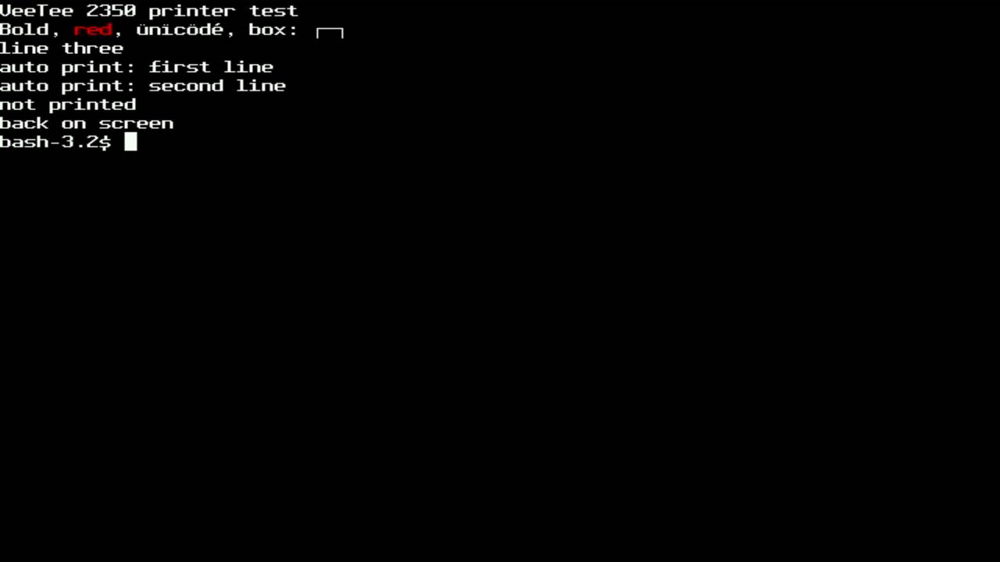
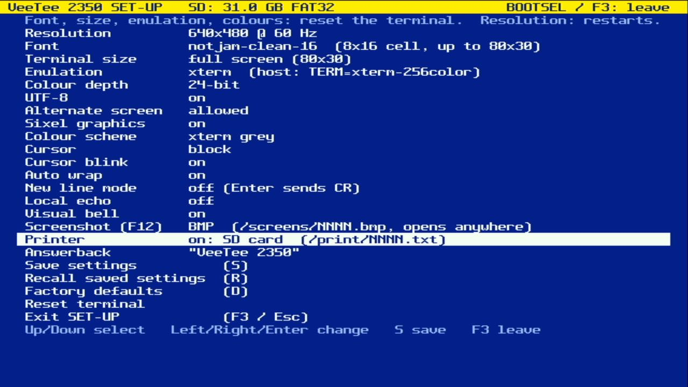

# 018 — Turning on the printer

*2026-11-02*



DEC terminals had a printer port, and a host could drive it with the
Media Copy controls. The VeeTee's printer is the SD card: switch it on
in SET-UP ("Printer: on: SD card") and print jobs land in
`/print/NNNN.txt`. Each time the printer is switched on, its first
job starts a new file, like loading fresh paper.

| Sequence | What it prints |
|---|---|
| `CSI i` | the screen: the scrolling region, or all of it with DECPEX (mode 19); a form feed after with DECPFF (mode 18) |
| `CSI ? 1 i` | the cursor line |
| `CSI ? 5 i` / `CSI ? 4 i` | auto print on/off: each line as LF, VT or FF leaves it |
| `CSI 5 i` ... `CSI 4 i` | printer controller mode: everything in between goes to the printer and *not* to the screen |
| `CSI ? 15 n` | status: `?10n` ready, `?11n` no card, `?13n` printer off |

Text is printed as a VT sends it to its printer: one line per screen
row, trailing blanks dropped, CR LF at the end, here in UTF-8. The
test script above, run from a shell, produced this file (shown with
`od -c`, abridged):

```
V e e T e e   2 3 5 0   p r i n t e r   t e s t \r \n
B o l d ,   r e d ,   ü n ï c ö d é ,   b o x :   ┌ ─ ┐ \r \n
l i n e   t h r e e \r \n
\r \n ... (to the bottom of the screen, then the cursor line)
a u t o   p r i n t :   f i r s t   l i n e \r \n
a u t o   p r i n t :   s e c o n d   l i n e \r \n
R A W :   c o n t r o l l e r   d a t a ,   n o t   o n   s c r e e n \r \r \n
```

The last line's `\r\r\n` is the host's tty turning the script's `\n`
into `\r\n` after its own `\r`: controller mode really does pass bytes
through untouched.

## Controller mode can't go through libvterm

Everything after `CSI 5 i` must bypass the screen until `CSI 4 i`.
But libvterm parses the whole buffer it's handed before any callback
could divert the rest. So when a printer is attached, incoming bytes
go through a small matcher first (`lib/term/printer.c`). It recognises
`ESC [ 5 i` and `ESC [ 4 i` (and the 8-bit CSI forms in 8-bit mode)
itself, holding back at most three bytes of a possible match, so a
sequence split across USB packets is still caught. Look-alikes go
where they belong: `ESC [ 5 m` is blink on the screen, and inside
controller mode it's just printer data. The same pass splits the
stream at line breaks for auto print.

One bug the unit tests caught: auto print switched on and a line
break arriving in the same packet weren't printed, because the matcher
checked "auto print on?" before libvterm had seen the `CSI ? 5 i` in
front of it. The bytes before every line break are now handed over
first.

## Keeping the paper safe

The file is closed at the end of every job (screen, line, controller
session), so pulling the card between jobs loses nothing. Auto print
has no end of job, so its file is closed after a second without
output.



SET-UP had to make room again: on a 24-row screen it now puts its
messages in the title row.
