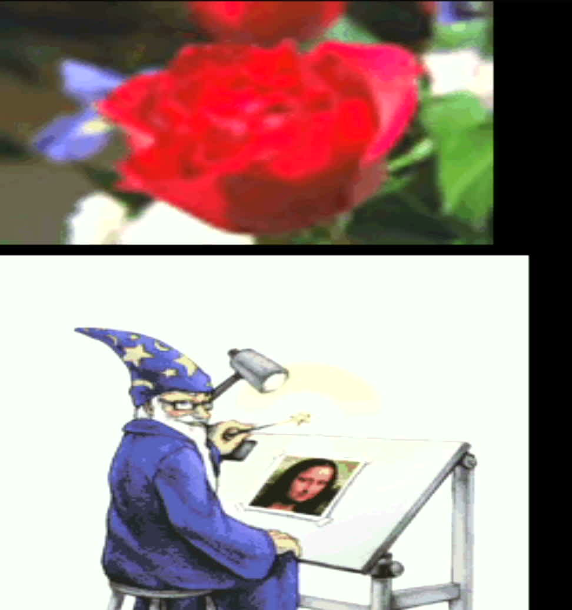
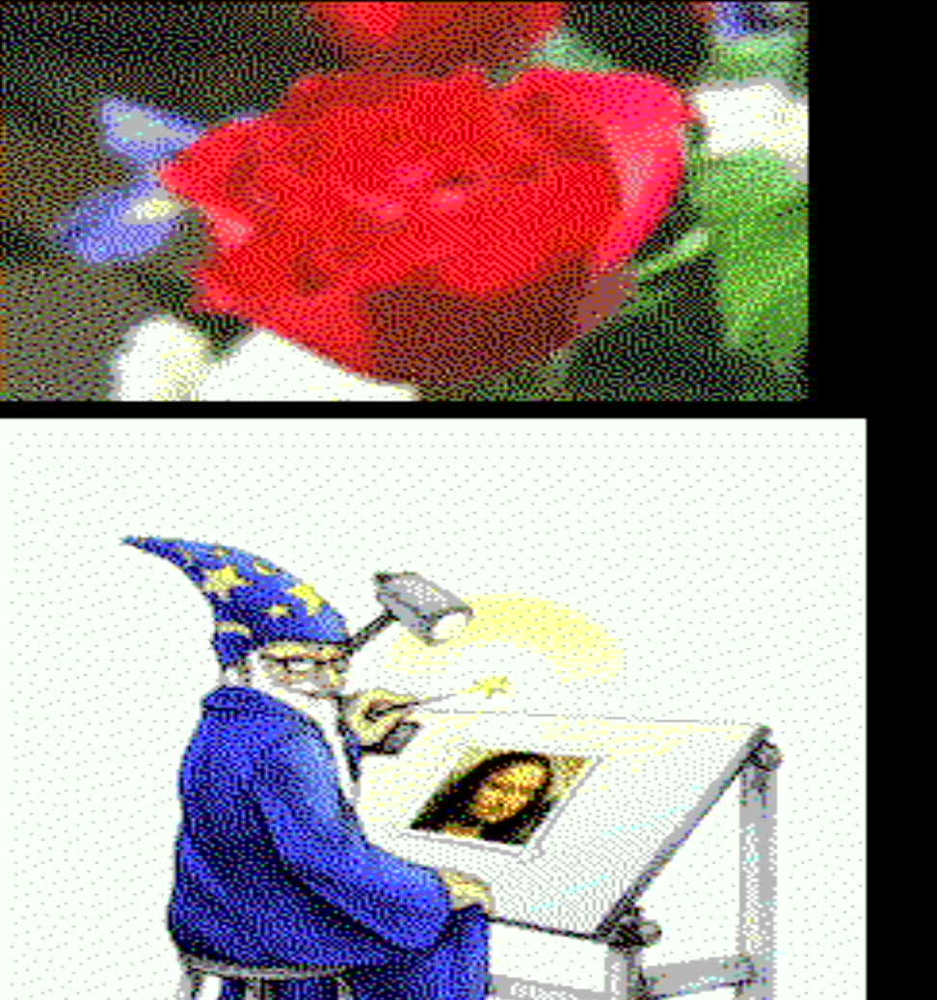
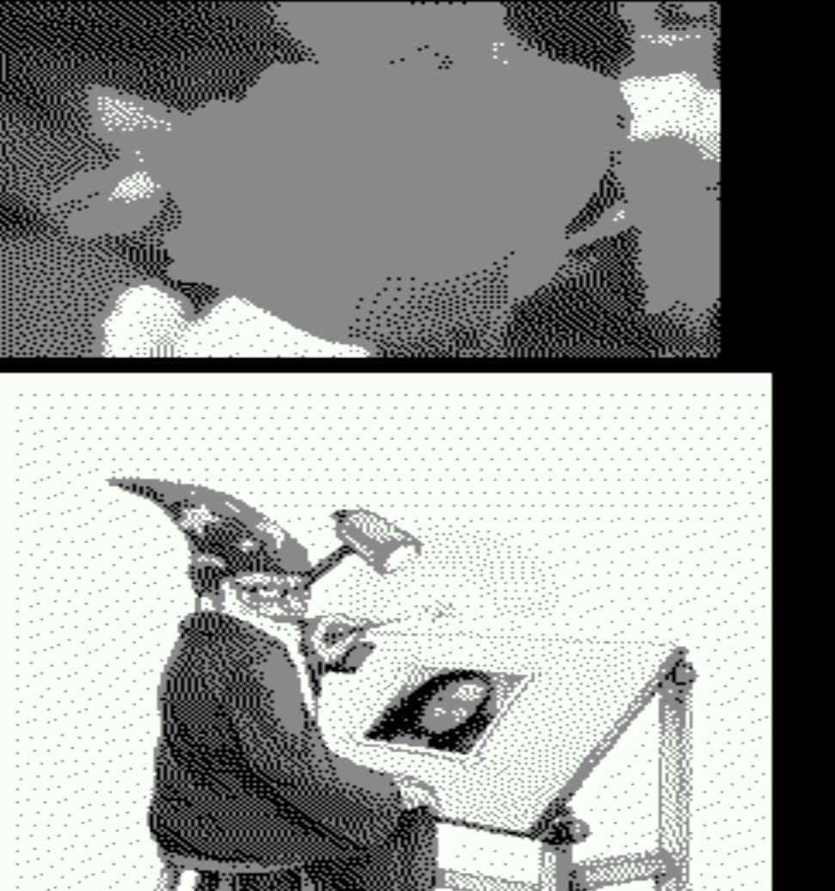
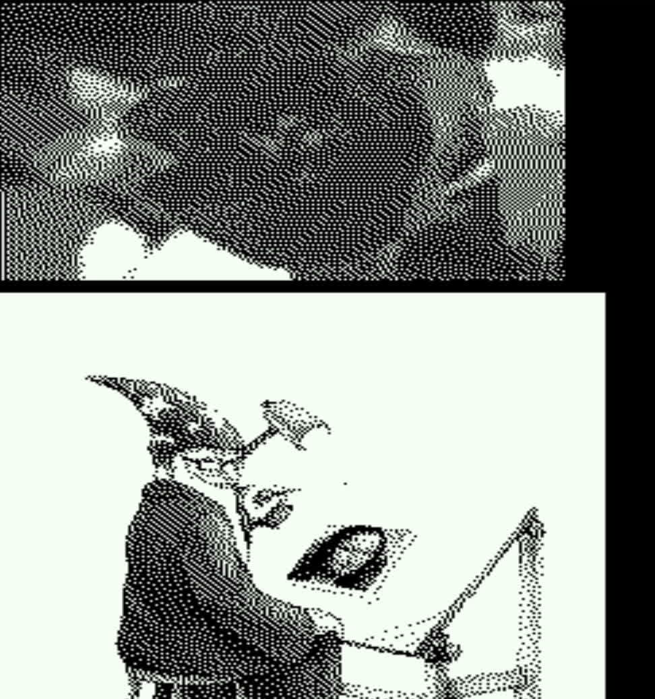

# 019 — Fewer bytes, fewer bits, and Floyd–Steinberg

*2026-11-02*

| 8 bits (255 colours) | 4 bits (CGA, dithered) |
|---|---|
|  |  |
| **2 bits (greys, dithered)** | **1 bit (ink, dithered)** |
|  |  |

Phase G was about memory: how much screen fits in the RP2350's 520 KB,
especially at 1280x720, where the text grids alone ate most of what
Sixel needed.

## 8-byte cells

A cell was 12 bytes: glyph, attributes, and two 32-bit words holding
the background and `fg ^ bg` already doubled into both halves, which
is what the renderer's hot loop wants. It is now 8 bytes: the two
colours as plain RGB565, exactly what reaches the screen, and the
renderer builds the doubled words itself. One 32-bit load fetches
both colours, then a handful of ALU ops.

- Grids are a third smaller: 1280x720's two 160x45 screens went from
  173 KB to 115 KB.
- Cost: about +260 cycles a line at 640x480 (4093 to 4350 of an 8000
  budget); 7910 of 16500 at 720p. No colour is lost.

## Sixel at 8, 4, 2 or 1 bits a pixel

SET-UP's "Sixel graphics" now cycles off / 255 colours / 15 / 3 / 1.
Fewer bits a pixel means more picture in the same pool: at 640x480 the
256 KB pool holds 2048, 4096, 8192 or 16384 picture cells (the whole
80x30 screen is 2400). The VT340 emulation level defaults to 4 bits,
its own 16 colour registers.

At 8 bits images keep their own colours (up to 255 on screen at once).
Below that the palette is fixed, and images are **Floyd–Steinberg
dithered** into it:

- 4 bits: the 16 CGA colours, less dark grey (one value means
  transparent).
- 2 bits: black, grey and white, a greyscale dither.
- 1 bit: a single ink, the terminal's foreground colour, against its
  background: the monochrome-terminal look.

Sixel doesn't arrive in raster order. A band six pixels tall is
painted one colour register at a time, so a pixel's colour is only
known once its band is complete. The decoder's paints are recorded per
band (register numbers, about 18 bytes per pixel of width in all), and
when the next band starts the finished one is dithered row by row,
pushing error right and down, with the last row's error carried into
the next band. Unpainted pixels stay transparent and don't spread
error. Without memory for the band it falls back to nearest colour.

## Rendering pictures fast enough

The first try at packed pixels blew the line budget: the 4-bit screen
above starved the display, and a full-width picture line cost 13800
cycles against 8000, at *any* depth. The renderer interrupt then never
let the main loop run, and the watchdog reset the board. It took four
changes, each measured with the stats build:

| Change | Full-width picture line |
|---|---|
| per-pixel decode, `memcpy` of the palette (which runs from flash) | 13762 |
| decode a byte at a time, the palette's "transparent" entry as per-cell scratch for the background | 11556 |
| read tile rows as whole words | 9817 |
| palette in scratch RAM, away from the encoder's bus traffic | 9464 |
| inline the decode into the hot loop, per-line state | **6566** |

The big one was the last: the per-cell function call reloaded half a
dozen fields from the render struct in contended main SRAM. With a
screen full of pictures every depth now peaks around 6000 cycles, with
no starved lines.

Two more fixes came out of it:

- **A bus fault at 1 bit.** The hot loop read the font glyph row
  *before* checking whether the cell was a picture, whose "glyph" is a
  tile number. With 16384 tiles that read ran off the end of RAM.
- **A safety valve.** One render interrupt may now spend at most four
  line-times; past that it masks itself until the main loop's next
  pass. An overloaded screen tears; it no longer reboots the board.
