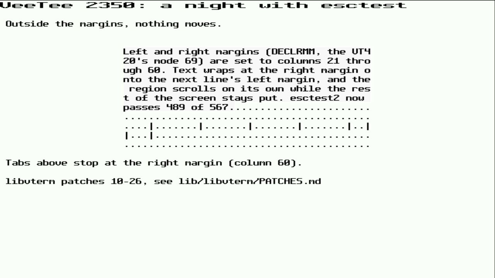

# 020 — A night with esctest

*2026-11-02*

The SD card, screenshots, printer and Sixel depths were done, and
the board was left running overnight. The rest of the night went to
esctest2: flash, run the 567 tests through `tools/hostshell.py`, read
the failures, patch, repeat. `tools/esc_summary.py --compare` says
what changed since the last run, which is how regressions get caught
(one did: a tab fix that also stopped CBT at the left margin).

| Run | Pass | What changed |
|---|---|---|
| 10 | 407 | where the night started |
| 11–13 | 451 | DECBI/DECFI, margins for cursor motion, window ops, DECID |
| 14–16 | 474 | a DECSC save per screen, text and index at the left/right margins, xterm 383+ reverse wrap, DECSCL levels |
| 17–18 | 479 | REP prints like text; NEL, DCH and one-line DECSTBM |
| 19 | 482 | CUB with reverse wraparound |
| 20 | 484 | XTSAVE / XTRESTORE |
| 21–22 | 488 | tabs at the right margin, DECSET 41, alternate-screen clearing |
| 23 | 489 | CHA and HPA under origin mode |
| 24 | 491 | DECNCSM only at VT510 level; OSC 104 resets the special colours |
| 25–26 | 494 | ISO protected areas (SPA/EPA) |

That's libvterm patches 10 to 27 (`lib/libvterm/PATCHES.md`). Most are
a few lines each; a few of them are worth telling.

## Left/right margins are everywhere

DECLRMM (the VT420's left/right margins, mode 69) is the reason for
half of these. Upstream libvterm has the margins and uses them to
scroll, but most other things ignore them: text didn't wrap at the
right margin, CR didn't go to the left margin, LF outside the margins
still scrolled the region, and tabs ran past the right margin. xterm
and the VT420 agree on what should happen, and esctest checks nearly
all of it. Most of patches 11–23 are one rule each.

The picture is the board showing them off: margins at columns 21 and
60, a paragraph wrapping inside them, and a row of tabs that stops at
the right margin and carries on below. (The double-width title had to
be drawn after the margins were switched off: setting DECLRMM turns
every double-size line back to single size, as on a VT420.)

## Reverse wraparound has two meanings

Backspace at column 1 with reverse wraparound (mode 45) on goes to the
end of the line above. Since xterm patch 383 it only does that if the
line above actually wrapped onto this one; the new mode 1045 does it
always, and also wraps from the top of the screen to the bottom.
esctest defaults to the old behaviour unless you pass
`--xterm-reverse-wrap=390`. VeeTee says it's xterm 390 in DA2, so
that's the flag the runs use. CUB has to behave like that many
backspaces, so BS's logic became a function CUB can repeat.

## The test that only failed on the board

`DECSET_ALTBUF` passed on the host and failed on the board, even when
it ran alone. The board, asked by hand, did the right thing: switch
to the alternate screen, write, read it back. The answer was the
*last* assertion in the test, which has the same text as the first.
DECSET 47 is supposed to leave the alternate screen alone, so what
you wrote is still there next time; libvterm (and VeeTee's own grid
code, to be sure) cleared it on every entry. xterm clears at
different moments per mode: 47 never, 1047 on the way out, 1049 on
the way in. Patch 25 does that.

## Colours that leaked between tests

`ResetSpecialColor_Multiple` passed alone and failed in the full run.
esctest resets colours between tests with a bare OSC 104, and in xterm
that resets the special colours (bold, underline, blink, reverse,
italic; OSC 4 indices 256–260) as well as the 256-colour palette.
VeeTee's OSC 104 only did the palette, so a special colour set by an
earlier test was still there, and became the "original" the next test
compared against. Now a bare OSC 104 resets them too, and 104;256–260
reset them one at a time.

## What's left

Most of the remaining failures can't or shouldn't be fixed:

- 21 Xcms colour tests: they expect one X server's colour
  characterisation.
- Window and page resizing (DECSLPP, DECSNLS, 80 ↔ 132 at 640 wide):
  the screen size comes from SET-UP.
- DA1 lists fewer attributes than xterm's (2 tests): VeeTee only
  claims what it does.
- Two ISO-protection tests are now "expected failures": DECSED and
  DECSEL honour SPA protection, as xterm does, which esctest calls a
  known xterm bug.
- `ResetSpecialColor_Dynamic` resets the foreground (OSC 110) and
  expects black, because esctest's per-test reset sets OSC 10/11 to
  black on white "to work around a bug". OSC 110 goes back to the
  configured scheme, so the test only passes with a black-on-white
  scheme. (That reset is also why the board's screen was black on
  white for the picture above.)

Firmware update from the SD card is still waiting: it can brick the
board, and someone has to be awake to hold BOOTSEL.
