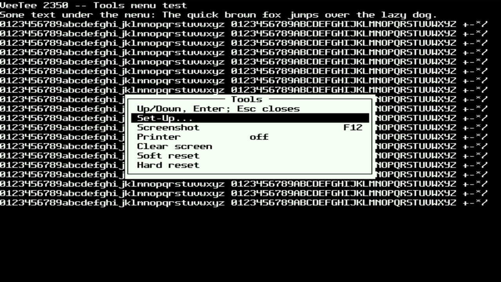
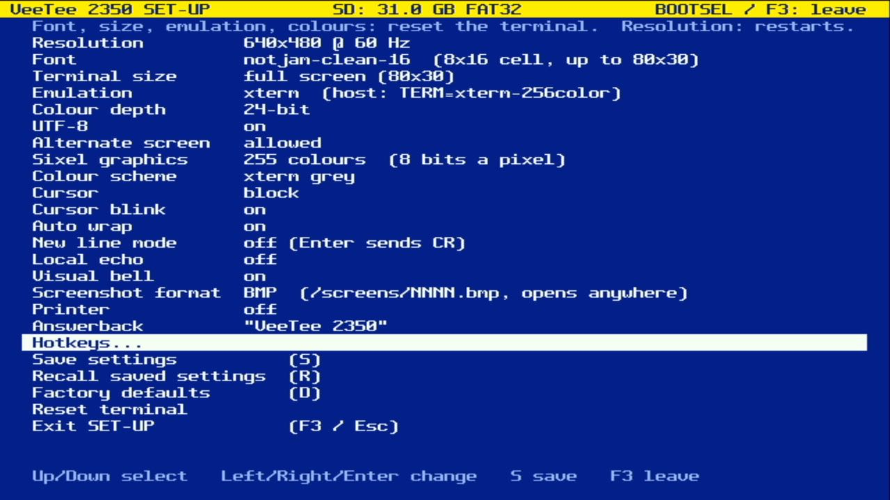
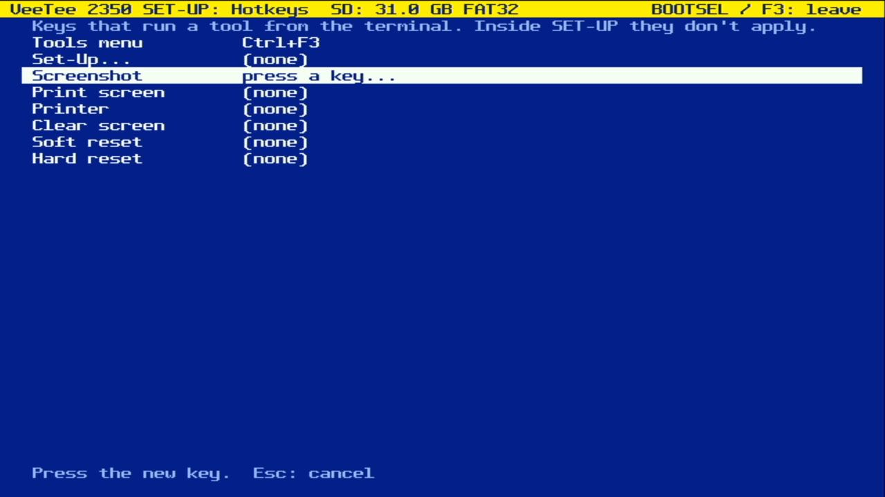
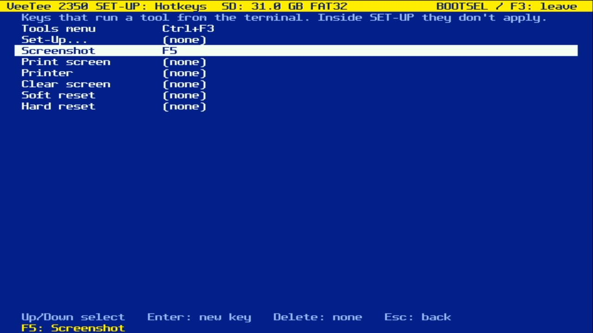
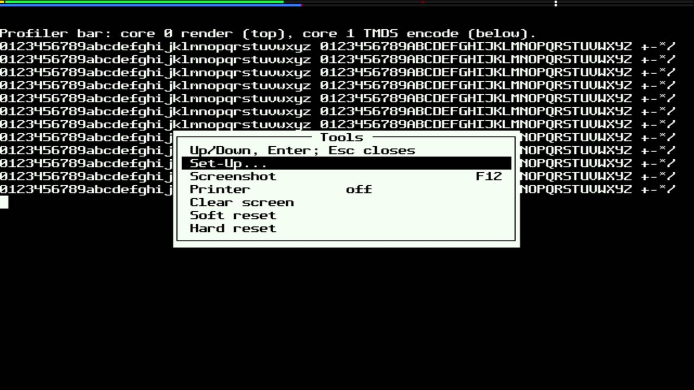
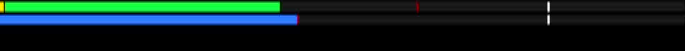
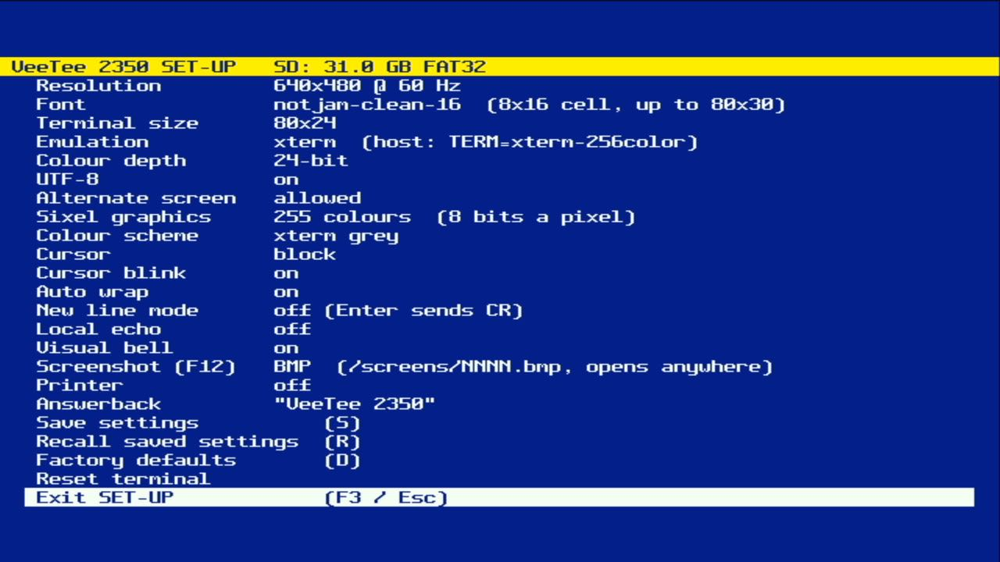
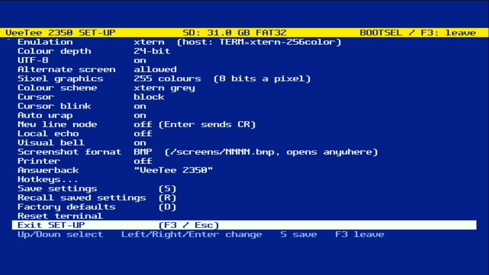
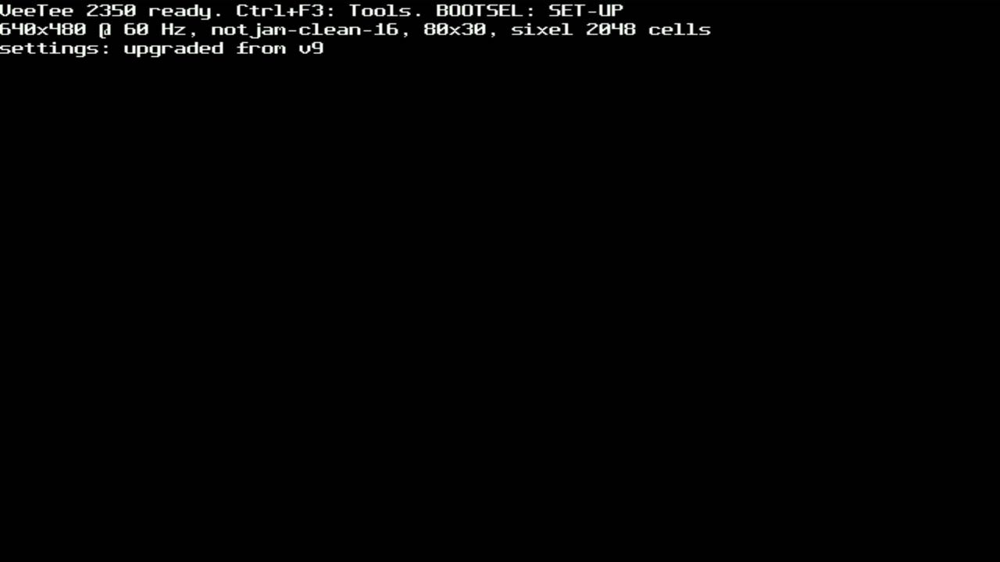

# 021 — A Tools menu, hotkeys, and a profiler bar

*2026-11-02*

F3 used to open SET-UP, like the Set-Up key on a VT220. That made F3
useless to programs on the host (mc, for one, wants it), and SET-UP was
turning into the place every local action lived. Now **Ctrl+F3** opens a
small **Tools menu** over the live screen: Set-Up, Screenshot, Print
screen, Printer on/off, Clear screen, Soft reset (DECSTR), Hard reset
(RIS). Plain F3 goes to the host. Capture, replay and file transfers
will join the menu as they're built.

## Modifiers

The keyboard port carries what an xterm keyboard sends, and xterm puts
modifiers in a parameter: `ESC [ 1 ; 5 R` is Ctrl+F3 (5 = 1 + Ctrl's
4), `ESC [ 13 ; 5 ~` is the same key in the other notation, and old
xterms sent `ESC O 5 R`. `keys.c` had been reading those and throwing
the modifier away, so Ctrl+F3 was just F3. It now keeps them in
`key_event.mods`, and ESC + a printable byte is Alt plus that key. The
USB HID keyboard (Goal 3) will fill the same bits in directly.

## Hotkeys

Which key does what is a setting. SET-UP's new **Hotkeys...** page
lists the tools; Enter, then the key you want:

| Waiting for a key | Bound |
|---|---|
|  |  |

Esc cancels (so Esc can't be a hotkey), Delete unbinds, and a key runs
one tool: binding it to another tool takes it away from the first, and
the message line says so. The defaults are Ctrl+F3 for the menu and F12
for screenshots, as before.

One thing not verified on the board: after binding F5 to Screenshot I
pressed F5 in the terminal, but the 100 ms confirmation flash is over
long before the capture card's frame arrives, so the picture shows
nothing. The dispatch is the same code that opens the menu on Ctrl+F3,
which does work; whether `/screens` got a new file waits for the card
to come out.

## Overlays, and what they cost

The menu is drawn into its own cells and handed to the renderer as an
**overlay**: on the scanlines it covers, the renderer copies the grid's
row, lays the menu's cells over it, and draws that. The screen
underneath is never touched, so host output keeps landing behind the
menu, and readback (DECRQCRA) and printing never see it. The cursor is
skipped where an overlay hides it. The VT100 user lights will use the
same mechanism next.

I guessed the copy would cost about 700 cycles a line. Then I measured
(new `VEETEE_RENDER_PROFILE` builds, `env:pizero-profile`, which time
pieces of the renderer with core 0's cycle counter and print them with
the other stats): **2105 cycles** a composed line, three times the
guess. The row is copied from main SRAM while core 1 hammers it with
TMDS encoding. Composing each text row once per frame and reusing it
for the row's other 15 glyph lines brought it to **226** on average:

| 640x480, 80x30 of text | render avg | render max |
|---|---|---|
| no menu | 4072 | 4230 |
| menu, composing every line | 4668 | 6096 |
| menu, once per row per frame | 4135 | 5995 |

The worst line still pays the full copy (the first line of each
covered row); the line buffers absorb it, but over a full-screen Sixel
picture it would cross the 8000-cycle budget. The instrumentation stays
in the code, off by default.

## The profiler bar

For fun, and because the numbers above should be visible without a
serial cable: SET-UP's **Profiler bar** turns the top eight scanlines
into two bar graphs of the last frame. Top: core 0's render, a line on
average, split into overlay composing (yellow, profile builds only)
and everything else (green). Below: core 1's TMDS encode (blue). Red
ticks mark each bar's worst line, white ticks the budget, at 80% of
the width so an overrun still has room to show. Above, with the menu
open: render 41% of the way, worst line near 60%, encode 43%.

## Things that broke

**SET-UP on a 24-row screen.** Adding the Hotkeys item meant counting
rows, and SET-UP had a bug already: it put every item on screen at
once and assumed 24 rows were enough. At 23 items, on an 80x24
terminal, the help line had already fallen off the bottom:

| Before (help line gone) | After (scrolls, help line back) |
|---|---|
|  |  |

The list scrolls now, with `^` and `v` in the margin when there's more,
and the help and message lines always sit at the bottom.

**Settings lost to a version bump.** Settings are a struct written to
flash with a version number, and until now a new version meant
"anything older is garbage: factory defaults". The hotkeys made it
version 10, and the board came up with defaults. Since version 9,
though, fields have only ever been appended, so an old record is a
prefix of the new one. `settings_upgrade()` now keeps an old record's
fields (up to where they ended, not its padding, which is where the
new fields live) and defaults the rest. The boot banner says which
happened:

