# 022 — User lights and a status line that peeks

*2026-11-02*

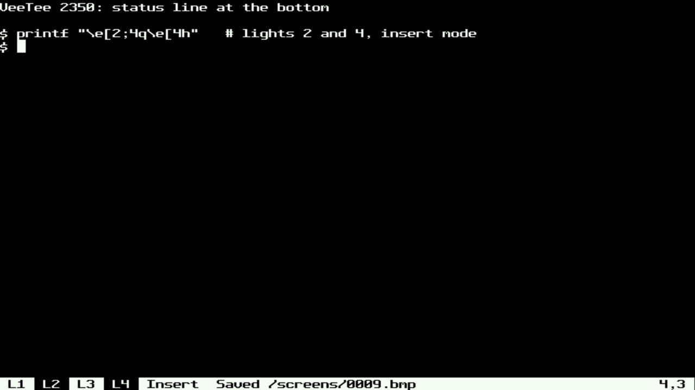

The VT100 had four LEDs on its keyboard, L1 to L4, that the host could
switch on and off with DECLL (`CSI Ps q`). Nobody remembers them, which
is reason enough to have them. The later DEC terminals grew a **status
line** under the screen instead: line 25 on a VT320, showing the
printer, the cursor position and so on, or text the host wrote there.
VeeTee now has both, and the lights live in the status line.

## The lights

`CSI 1 ; 3 q` lights L1 and L3, `CSI 0 q` (or `CSI q`) puts them all
out, and 21–24 put out one at a time, as on a VT510. A reset (RIS) puts
them out; DECSTR doesn't. They need somewhere to show, and the default
is no status line, so with it hidden the lit ones sit in the top right
corner, in the same overlay mechanism as the Tools menu (devlog 021):

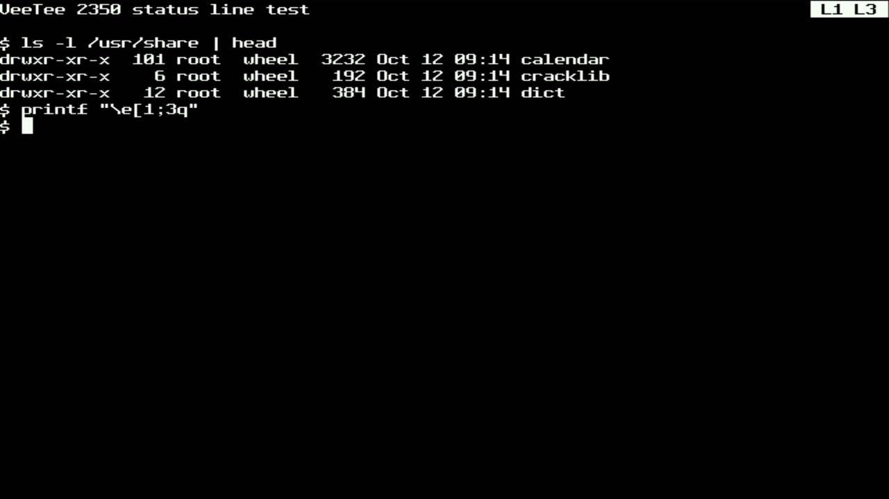

The corner overlay is only there while a light is lit, so an idle
screen looks as it always did.

RIS needed a hook. libvterm handles `ESC c` itself and tells nobody, and
the lights aren't libvterm's. Patch 28 gives `VTermStateFallbacks` a
`reset(hard)` member, called at the end of every reset.

## The status line

SET-UP has two new items, **Status line** and **Peek time**:

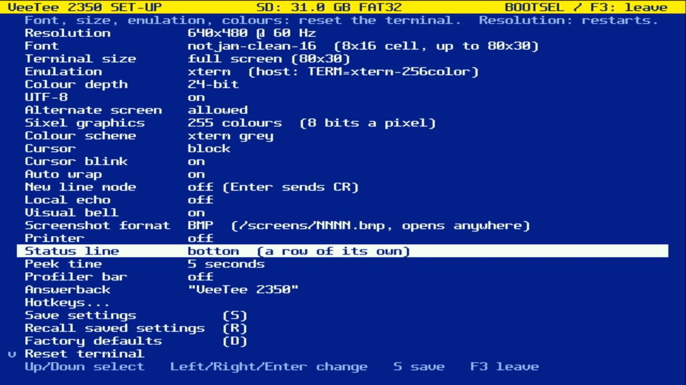

**Bottom** and **Top** give the status line a row of its own. The
renderer treats it as one more row of cells, outside the grid:
`render->status_cells`, drawn on the scanlines marked `RENDER_LINE_STATUS`
in the line table, laid out by `render_init` with the text so the two
are centred as one block. libvterm, the grid, readback (DECRQCRA) and
printing never see it. Screenshots do, because they read scanlines.

| Bottom | Top |
|---|---|
|  | 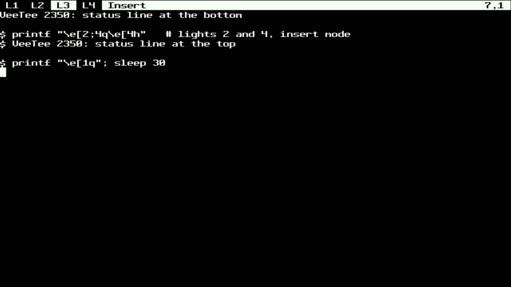 |

It's in the theme's colours swapped, as the Tools menu is, so it reads
as the terminal's own chrome and follows a colour scheme. A lit light is
a box in the theme's own colours. Then come whatever the app has
switched on (the printer, for now), *Insert* while IRM is set, a
message, and the cursor position at the right. The F12 screenshot in
the picture put "Saved /screens/0009.bmp" there. That also settled the
open question from devlog 021: screenshots do reach the card, and now
the status line says so.

The row has to come from somewhere. At 640x480 the 8x16 font fills the
screen exactly (80x30), so the terminal goes to 80x29. With a fixed
size that leaves room (80x24 on that screen), the status row just takes
a spare one.

## Peeking

The user's addition: a status line that stays out of the way and
**peeks**. In the Peek modes the terminal keeps all its rows. When
something worth seeing changes (a light, the printer, a message, the
status type), the status row slides in over the edge row, stays for the
peek time and slides away. The cursor position updates while it's up,
but cursor movement doesn't trigger a peek, or it would never go away.

| Resting: row 30 is the terminal's | A light changes | 5 s later |
|---|---|---|
| 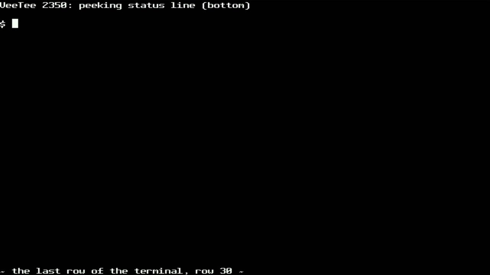 | 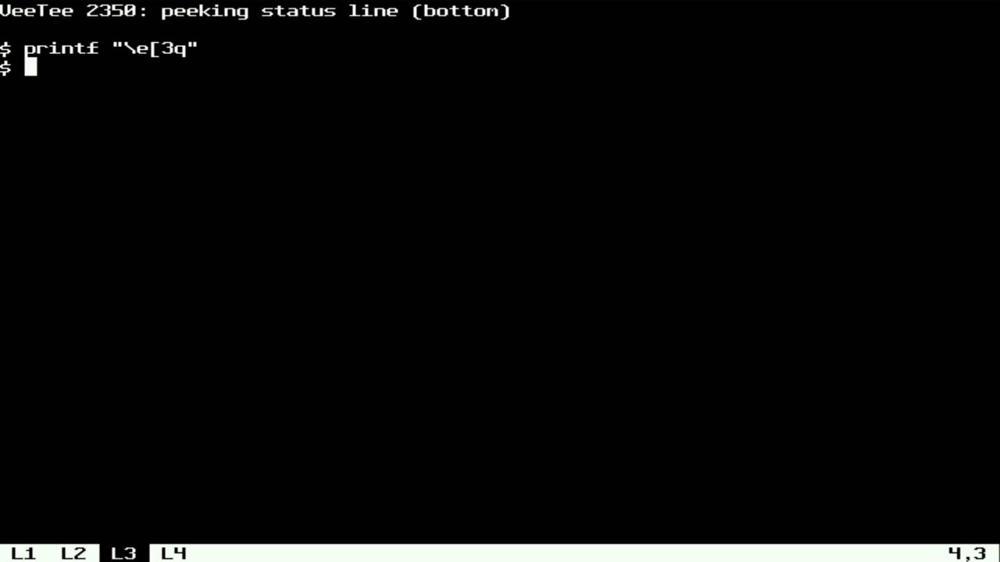 | 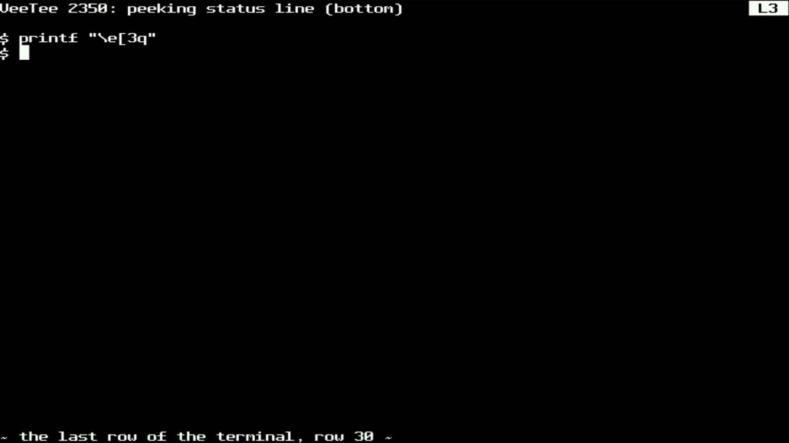 |

The slide moves an eighth of the font height a frame, so a 16-pixel row
comes in over 8 frames, about 130 ms. The capture card's frames come
about 0.7 s after asking, so catching the slide meant asking, waiting a
bit, triggering, and sweeping the wait. Two of five tries landed
mid-slide, about 5 and 9 scanlines in:

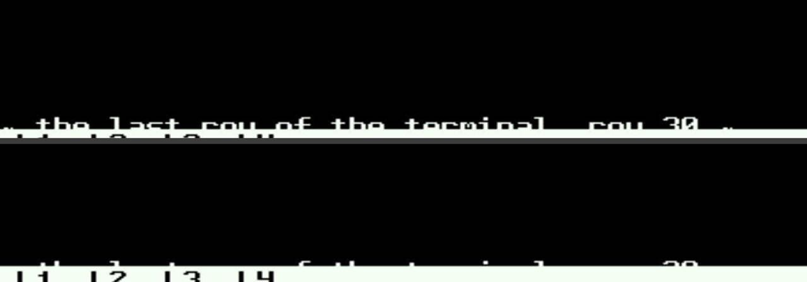

It rises top edge first, clipping the labels as it comes, like a blind
being pulled up. Peeking doesn't touch the grid. `render_status_peek`
rewrites the line table entries of the edge row only, pointing the
lines the bar covers at `RENDER_LINE_STATUS`, and puts them back as it
leaves. Peek top comes down over row 0 instead, here over a curses-style
title bar, with the screenshot message:

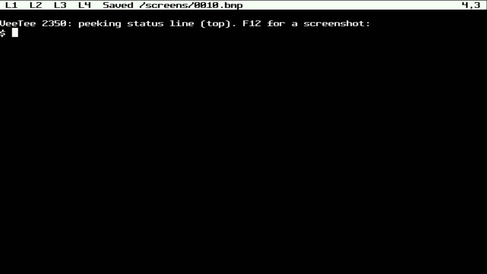

## The host's say

DECSSDT (`CSI Ps $ ~`, VT320 on) picks what the status line shows: 0
none, 1 indicator. In Bottom and Top, 0 blanks the row but keeps it, as
line 25 stayed there on a VT320. The terminal doesn't change size under
the host, and the lights go back to the corner:

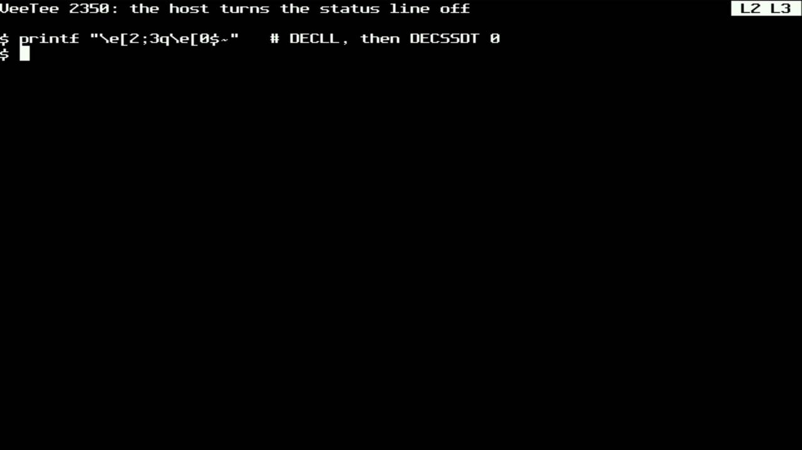

DECRQSS reports the type. 2, the host-writable status line, is the next
step (a second, one-row libvterm). Until then it's refused, and so is
DECSASD's `CSI 1 $ }`, which would route host text into it.

The plan had said a host asking for a status line while it's Hidden
would get one at the bottom. That would take a row from a running
program and change the terminal's size mid-session. Hidden now means
hidden: the host's choice is remembered and reported, nothing more.

## Things that broke

**231 cycles a line, for a test that wasn't in the loop.** The first
version handled the status row inside `render_scanline`: a flag, then
the status cells in place of the grid's, and no cursor or DECSCNM. That
was a few ternaries per line, outside the column loop, so it should
have cost almost nothing. Instrument first (devlog 021), on the same
screen of text (80x30, `env:pizero-profile`, with the status line
hidden):

| Build | render avg | max |
|---|---|---|
| before (devlog 021's code) | 4019 | 4126 |
| status test inside the text path | **4250** | 4357 |
| status in its own function, GCC inlined it anyway | **4418** | 4565 |
| own function, `noinline` | 4065 | 4182 |

So the cost wasn't the test. GCC inlined the status drawing back into
`render_scanline` and the 80-column loop compiled worse around it.
With `noinline` most of it goes away. The last ~46 cycles (1.1%) follow
the hot loop's place in SRAM: `render_scanline` moved 180 bytes to make
room. Defining the new function after it didn't move it back, and that
was where I stopped. The measured cost of carrying a status line is
1.2%.

**The status row itself was slow.** Drawn through `draw_cell`, a call
per cell, its lines took **6747** cycles at 80 columns, against 4160
for a text line. That's under the 8000 budget, but with no margin to
spare. The same inline `emit8` loop the text path uses brought it to
**4204**. With the row showing, the frame now averages 4024, less than
before, because a mostly blank status row is cheaper than the text row
it replaced.

**A peek that would never end**, caught in review before it ran. A
message going stale bumped the counter that says "something changed,
peek". Every expiry would have started another peek, and with the
printer's text up, forever. Changes that redraw and changes that peek
now have separate counters, and a host test checks that a message
running out doesn't peek.

**Switching modes clears the screen.** Hidden to Bottom changes the
row count, and as with any geometry change in SET-UP, the terminal is
reset. The lights went out with it:

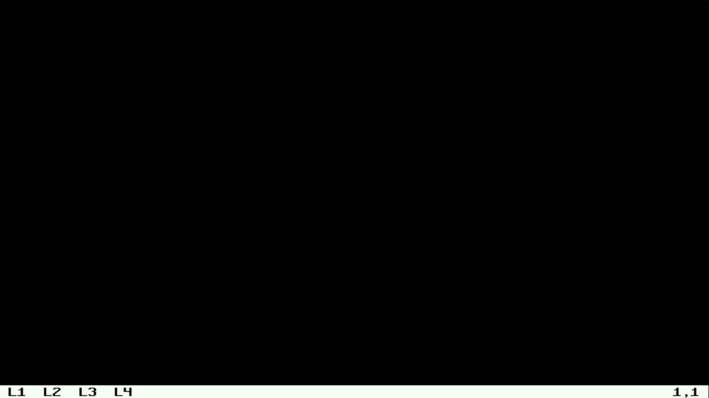

Bottom to Top keeps the row count, so that one only re-lays out the
renderer, and the screen, lights and Insert survive it (the Top picture
above is that). Resizing without a reset is a job for another day.

**Garbage in stack-allocated renderers.** Two render tests failed:
`render_init` read the new status fields from a `struct render` on the
stack, uninitialised. The overlay pointers had been just as
uninitialised since devlog 021, and the tests only passed by luck.
`render_set_screen`, which the header already said comes first, now
clears the struct.
