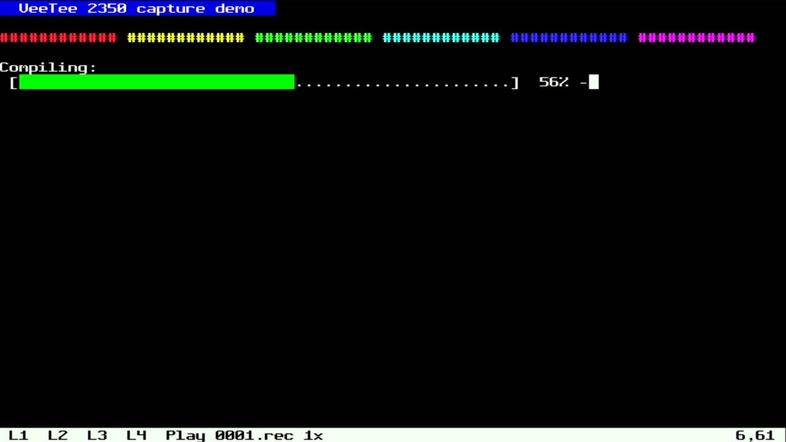
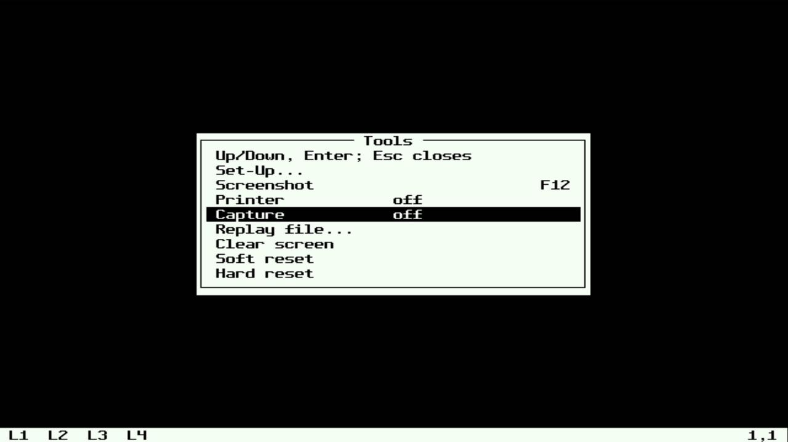
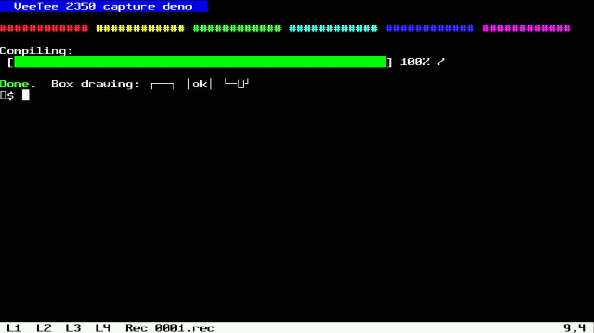
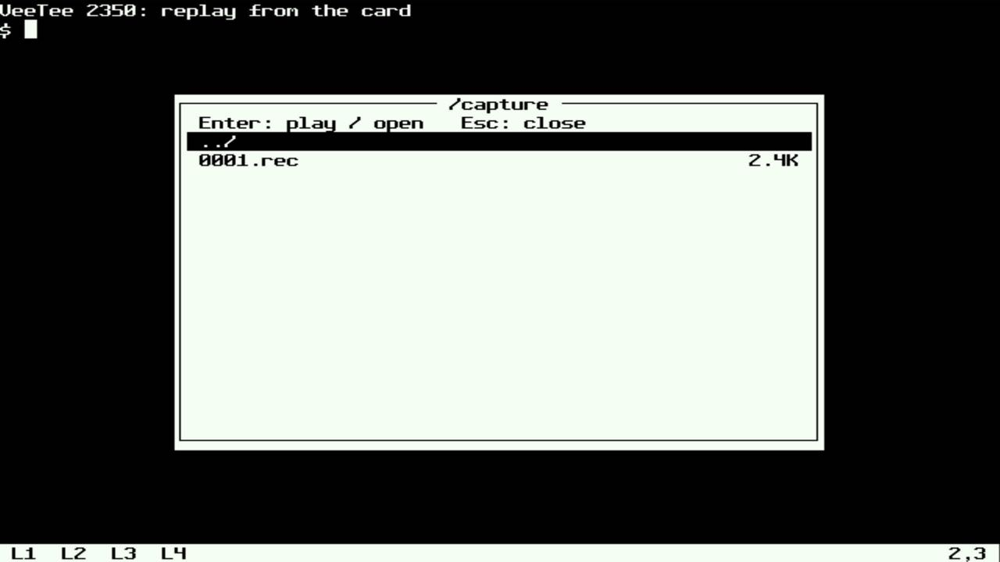
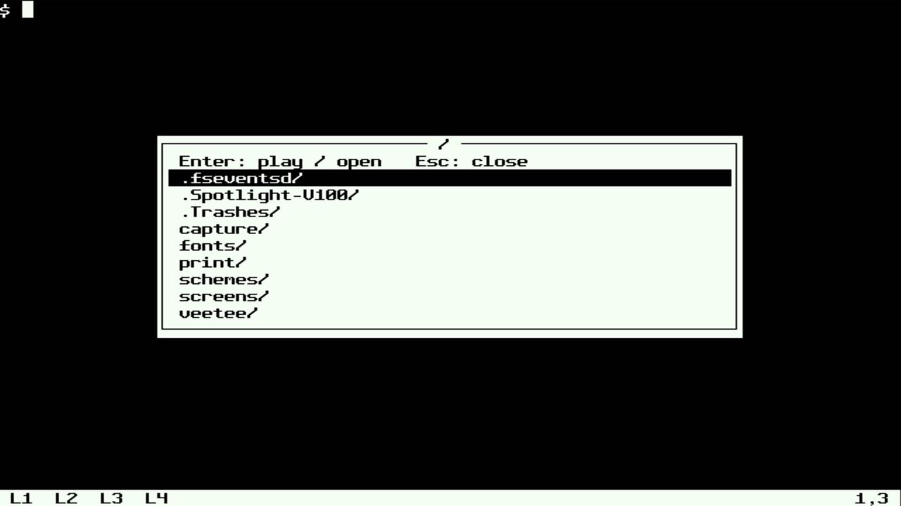
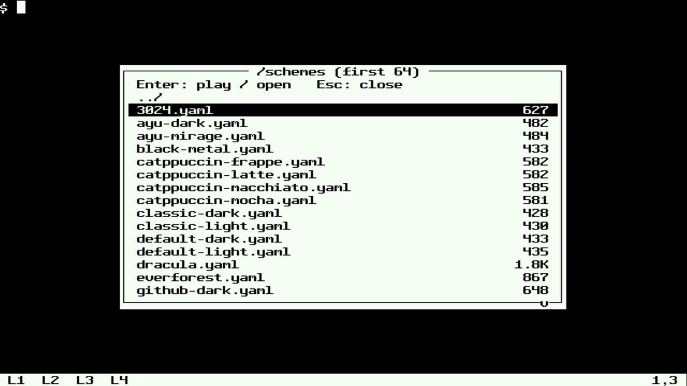
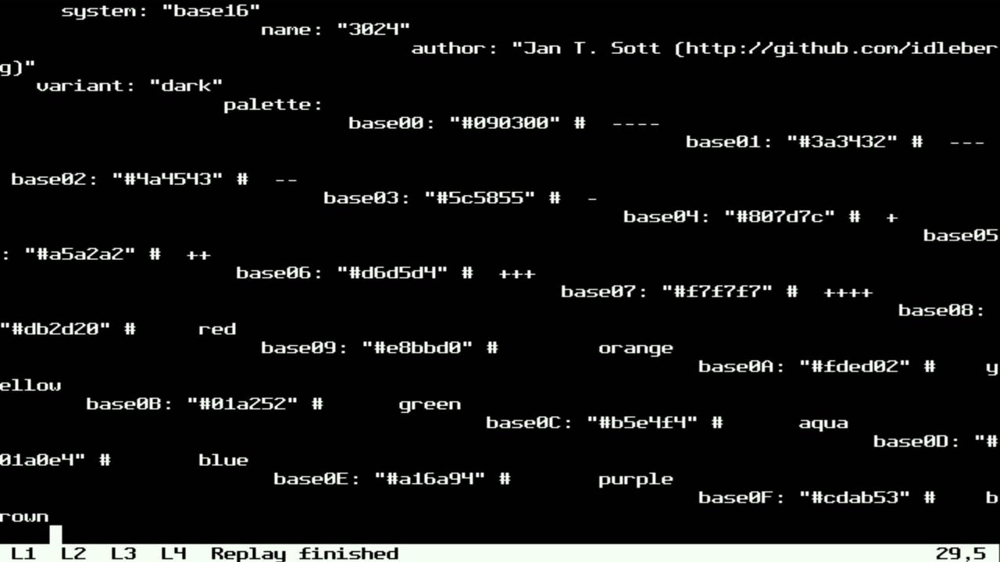
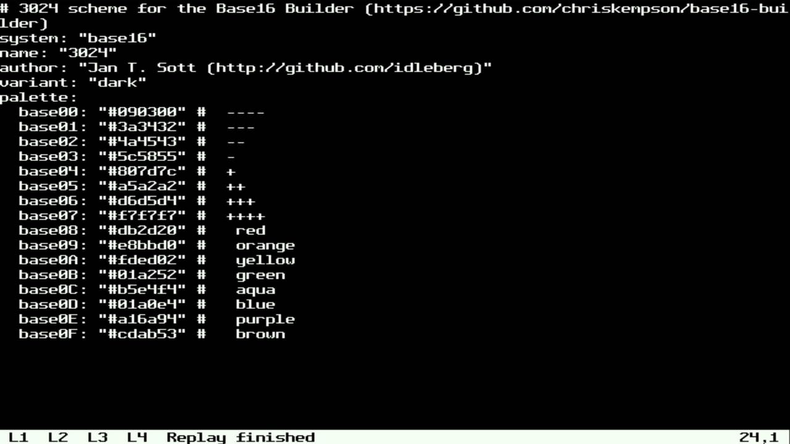
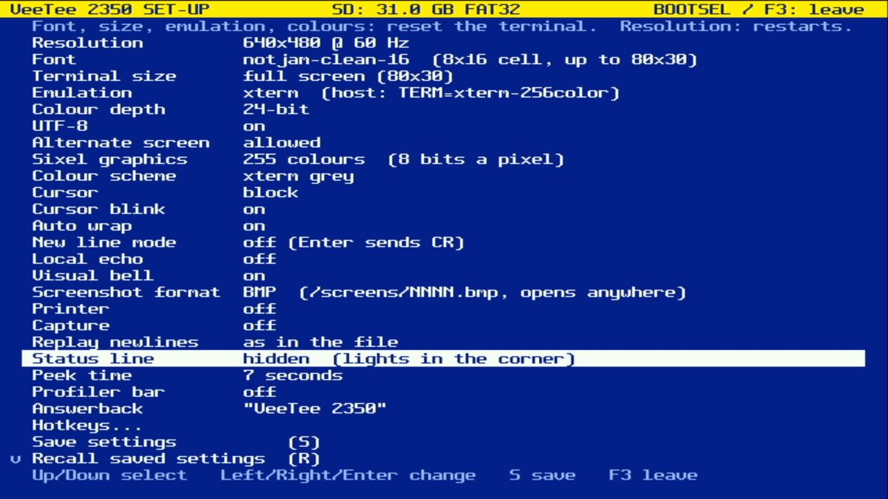
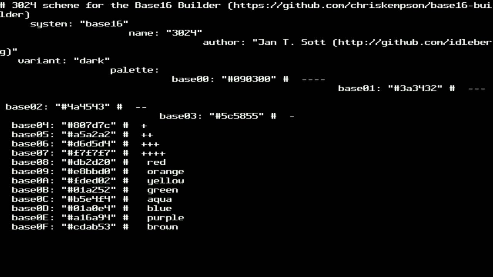

# 023 — Capture and replay

*2026-11-02*

The terminal can now record what the host sends it to the SD card and
play it back later, with its timing. That's for demos, for bug reports
("here's exactly what the host sent"), and, next, as a repeatable
workload for measuring the renderer.

## Capture

**Capture** is in the Tools menu (Ctrl+F3), bindable to a hotkey, and a
SET-UP item so it can start at boot:

While it's on, host output goes to `/capture/NNNN.rec` in **ttyrec**
format: each chunk of bytes behind a 12-byte header of seconds,
microseconds and length. ttyplay, ipbt and asciinema's importer read
it, and so does the replay below. There's no clock, so the times count
from boot, and players only use the differences anyway. The status line
says where it's going:

SD writes block the main loop for milliseconds, so bytes collect in a
4 KB buffer, already framed as records. They reach the card when the
buffer fills or output goes quiet for 200 ms. Bytes arriving within
10 ms of a record's start join it rather than getting a 12-byte header
of their own. As with the printer, the file is closed after a quiet
second and reopened to append, so pulling the card between bursts loses
nothing. If the card goes away mid-write, capture switches itself off
and the status line says why.

The "next NNNN" logic had been written twice already, for screenshots
and the printer. A third copy for captures was one too many, so it's
now `card_next_name()` in card.c, used by all three.

## Replay

**Replay file...** opens a file picker over the screen. It's a box like
the Tools menu: directories first, then files with their sizes, Enter
to go into a directory or play a file. The box drawing is now shared
(`lib/setup/box.c`), and the menu uses it too.

| /capture | The root | /schemes |
|---|---|---|
|  |  |  |

A ttyrec file plays with its own timing, long pauses cut to 2 s as ipbt
does. Anything else plays as raw bytes at 960 a second, a 9600-baud
line, which is how ANSI art was meant to arrive. The two are told apart
by the first headers: in text, any four bytes read as microseconds come
to at least 0x20202020, far past a million. While it plays, Space
pauses, Up/Down change speed (1/4x to 16x, and "max"), and Esc stops.
The Tools menu and hotkeys still work, so you can screenshot a replay.
Host output waits in the USB buffers until it's over. The terminal's
answers to queries in the file (DA, DSR) are dropped, since the host
never asked them.

The pacing (`lib/ttyrec`) is pure and host-tested: the record clock,
the gap cap, speed changes, "max" and back, and bytes arriving a few at
a time as the card reads them.

## Things that broke

**Box drawing, mangled, with capture on and off.** The capture demo
ended with a line of box-drawing characters, and the third box came out
"└─□┘", with a stray □ at the start of the next line:

Counting bytes put the 64-byte USB packet boundary in the middle of the
broken "─", whose UTF-8 is E2 94 80. A character split between two reads
broke whether capture was on or not:

![[A□B] with capture on, and with it off, plus a □ at the start of the next line](img/023-split-crop.jpg)

This had been there all along. Most output never hit a split character
at a packet boundary, or nobody noticed when it did. The cause is in
libvterm. In UTF-8 mode, G0–G3 are each a UTF-8 decoder with its own
"half a character so far" state, and a separate one, `encoding_utf8`,
handles chunks that start with a high-bit byte. A chunk starting "A E2
94" goes to G0's decoder, which keeps the half character. The next
chunk starts with 0x80, goes to the other decoder, and comes out as
U+FFFD. G0's leftover half then spoils the next ASCII chunk with a
second one. Patch 29: whenever the decoder would be a UTF-8 one, it's
always the shared one. A host test feeds a character in two pieces.

The recording made while it was broken has the right bytes in it, so
replaying it on the fixed firmware draws the boxes properly:

![The replay: └──┘ and [A─B], right this time](img/023-replay-end-crop.jpg)

**Staircases.** The card had no ANSI art, so the raw path got tried on
a colour scheme file:

Unix text ends lines with LF alone, and LF only moves down. When you
`cat` a file at a shell, the tty's `onlcr` adds the CRs. Raw replay is
standing in for `cat`, so the first fix made it do the same: a bare LF
went out as CR LF.

But a bare LF can be meant: ANSI art and curses output use it as plain
cursor-down, and converting it would wreck those. So it's a setting,
SET-UP's **Replay newlines**: *as in the file* (the default), *LF -> CR
LF in raw files*, or *in all files*. Pressing `n` during a replay flips
it, for a file that turns out to need it (the status line then says
"+CR"). Here `n` went in partway down the file:

| SET-UP | `n` pressed at base04 |
|---|---|
|  |  |

That made the settings record version 12. Like 9 to 11, it only
appended a field, so a saved v11 record upgrades in place, keeping its
fields. A host test covers it. The boot banner should say "upgraded from
v11", but see below for why there's no picture of it.

**A Mac's leftovers.** The card had been in a Mac, so the root listing
led with `.fseventsd/`, `.Spotlight-V100/` and `.Trashes/` (the root
picture above is from before this fix). Every directory also had a
`._` twin of each file. Dot names are hidden now, as `ls` does.

**Memory.** Capture's buffer, replay's buffer and the picker (64 names
and its cells) add about 14 KB of static RAM; the picker shares space
with the Tools menu, since they're never open together. That's 14 KB
less heap, which at 720p means a slightly smaller Sixel pool.

**The picture went away.** After a run of reflashes, the capture card
showed a flat black frame and stayed that way. The firmware still
answered over USB (DA, and a 640x480 / 80x30 size report). The last
committed firmware, flashed as a control, was black too, so the cause
sits between the board's HDMI and the grabber, not in this code. A
replug on the desk fixed it (devlog 024).
