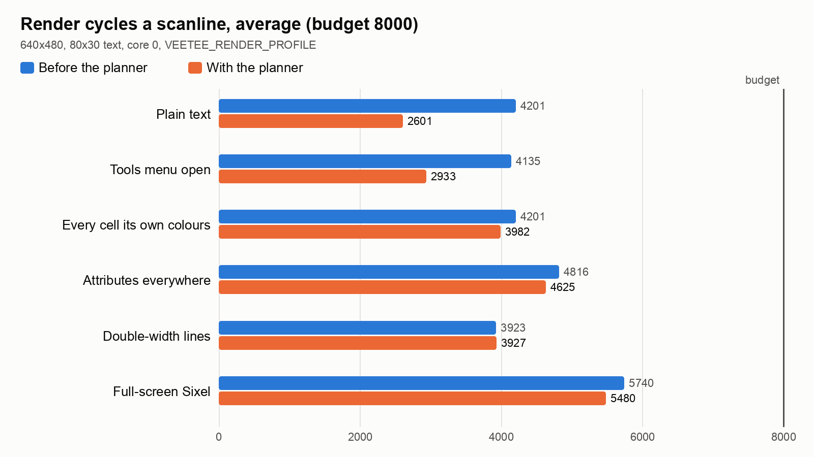

# 024 — A frame planner

*2026-11-02*

The renderer races the beam: core 0 draws each scanline in an interrupt,
a few lines ahead of core 1's TMDS encoder, inside an 8000-cycle budget
per line at 640x480. Each line it works everything out again, for every
cell: is this a picture? has it attributes? is an overlay over it? what
are its colours as pixel words? The user's idea was to stop
rediscovering the frame 480 times: *you know what you need to render,
so pre-plan and preload relevant data for the frame*. A plan can be a
frame late and tear, and that's fine. It's a text terminal on a
microcontroller.

## Instrument first

The profile build (`env:pizero-profile`) already timed whole lines.
This round added a counter around the column loop, and a script that
puts a known screen up and reads the numbers back over USB: plain text,
every cell in its own colours, attributes on every cell, double-width
lines, a full-screen Sixel picture. On plain text the loop was **96%**
of a line, about 50 cycles a cell, roughly twice what its instructions
should take.

Where do they go? A second build (`env:pizero-experiments`) re-runs
variants of the loop once a frame on line 240, into lines nobody sees,
each timed:

| Variant (80 cells of plain text) | Cycles |
|---|---|
| the real loop, in `render_scanline` | 4270 |
| a minimal plain-text loop, same work, into main SRAM | 3352 |
| the same, into SCRATCH_X (no DMA or core 1 traffic) | 3220 |
| loads and arithmetic only, no stores | 2898 |
| stores only | 822 |
| copying the row's cells into SCRATCH_Y | 1355 |
| the minimal loop reading those scratch cells | 2888 |

Two things came out of that. SRAM contention with core 1 is real but
small: 4% on stores, 14% on reading cells. And the real loop was 27%
slower than the minimal one doing the same work. The disassembly showed
why. With the Sixel and attribute state live, the plain-text path ran
out of registers: every cell reloaded the glyph table pointer and the
glyph size from the stack, and a test constant from the literal pool,
then took an extra jump. That's for screens with no Sixel and no
attributes on them at all.

## The plan

Once a frame, the main loop plans the next one (`render_plan`, a few
thousand cycles). Each text row becomes a handful of **spans**: runs of
cells from the grid row, or from an overlay. Each span is one of:

- **PAIR**: text without attributes, all in the frame's commonest fg/bg
  pair.
- **PLAIN**: text without attributes, in other colours.
- **MIXED**: attributes or Sixel cells.

The scanline just carries the plan out, with a loop specialised for
each kind:

- **Overlays are spans.** The Tools menu, the file picker and the corner
  lights are drawn straight from their own cells. Nothing is copied or
  composed in the interrupt any more (that was 2105 cycles on a covered
  row's first line).
- **PLAIN spans get a lean loop** with nothing else live, so the
  registers hold what text needs.
- **Preload the relevant data.** The commonest pair (a majority vote
  over last frame's cells) gets a 4 KB table: for each of the 256 glyph
  bytes, its eight pixels already in those two colours. A PAIR cell is
  then a glyph byte and 16 bytes copied; no colour arithmetic, no mask
  arithmetic. It's rebuilt only when the pair or reverse video changes.
  A PAIR row's cells are also copied into SCRATCH_X at its first
  scanline, and its other 15 lines read them from there.

A plan can be a frame old, which is the tearing the user allowed. A span
the host has just underlined may still say PAIR, so the lean loops stop
at the first cell they can't draw and hand the rest of the span to the
full loop: a stale plan costs speed, never pixels. Grid rows are looked
up at scanline time, so scrolling is never behind. What *can* be a frame
late: an overlay appearing or going away (the app replans at once when
it opens or closes one), and a PAIR span whose colours just changed.

## What it bought

640x480, 80x30, render cycles a line, average / worst line:

| Screen | Before | With the planner |
|---|---|---|
| Plain text | 4201 / 4347 | **2601** / 3366 |
| Tools menu open over it | 4135 / 5995 | **2933 / 3557** |
| Every cell its own colours | 4201 / 4340 | 3982 / 4157 |
| Attributes on every cell | 4816 / 5083 | 4625 / 4795 |
| Double-width lines | 3923 / 4049 | 3927 / 4052 |
| Full-screen Sixel | 5740 / 6587 | 5480 / 6268 |

The everyday case, a shell in the theme's colours, is 38% cheaper, and
the menu's worst line is 40% lower. Colourful and attributed screens
gain a little. Double-width lines take their own path and don't change.
The worst plain-text line went up (2935 to 3366) because it's the line
that does the preload copy. The ring of eight lines absorbs it, and
"slow at times" was allowed.

The instrumentation stays, off by default: the loop counter in profile
builds, the variants in `env:pizero-experiments`, and a
`VEETEE_NO_FRAME_PLAN` switch for A/B runs.

## Things that broke

**The lean loop alone was disappointing.** The first version (spans,
PLAIN and MIXED, no table) took plain text from 4270 to 3858, a tenth,
not the quarter the experiments promised. The disassembly showed the
attribute test's constant, `(0x1f | 0x2000) << 16`, still reloaded from
the literal pool every cell: it doesn't fit a Thumb-2 immediate. And the
colour words were still being built per cell. That's what led to the
pair table, which took it to 2662.

**Core 1 starved while a Sixel picture arrived.** The first lean loops
handed each cell they couldn't draw to an out-of-line function. That's
fine for one underlined cell in a stale plan. But while a Sixel picture
decodes, whole rows planned as text fill with picture cells, and every
one became a function call: **528 lines** with no line ready for core 1,
against none without the planner (an A/B run). Bailing out to the full
loop for the rest of the span fixed it: zero.

**Preload made colourful screens slower.** Copying rows into scratch
helped PAIR rows (2875 to 2583) and cost PLAIN rows 5% (4047 to 4239):
their loop is arithmetic, not loads, so the copy never paid back. Only
PAIR rows preload now.

**Sixel yields, older than this.** On a static full-screen picture, the
interrupt was yielding (its 4-line slice ran out) about seven times a
second, with or without the planner (the A/B switch proved it). With the
cheaper lines it doesn't any more in steady state, but it still does
while big screens are being drawn.

**A flash call in the render interrupt, since devlog 021.** Checking
that the new code stayed out of flash, I listed every RAM function that
long-jumps through a veneer. `render_scanline` tail-called
`__memset_veneer`, and memset lives in flash. GCC had turned
`fill_words(..., 0)` into a memset call: the profiler bar's blank
separator lines. The obvious fix, an `optimize("no-tree-loop-distribute-patterns")`
attribute on `fill_words`, worked but stopped it being inlined, and
colourful screens got 7% slower (3979 to 4273, twice). An empty asm
that hides the fill value from the optimiser does the job at no cost.
`render_scanline` now calls nothing outside RAM.

**No pictures.** Halfway through this round the capture card's picture
went black and stayed black, even with older firmware that was known to
work. The board answers over USB, so the trouble is between its HDMI
port and the grabber. Every number above came over USB; the chart is
drawn from them. Correctness rests on host tests: overlays as spans, a
stale PAIR plan drawing an underline, the pair table pixel-for-pixel
against the full loop with and without reverse video. **Nobody has
looked at this build on a screen yet.** 720p is unmeasured too:
changing resolution saves settings, and those are the user's.

**Memory:** two plans and the table, about 10 KB more RAM. The preload
row lives in SCRATCH_X, which had about 1.9 KB to spare.
