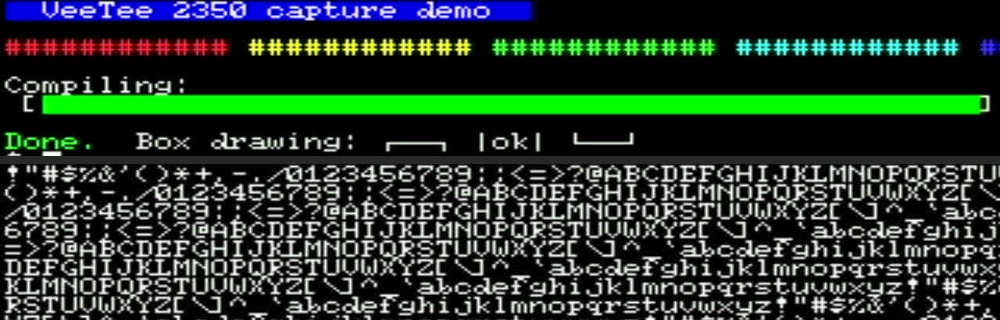
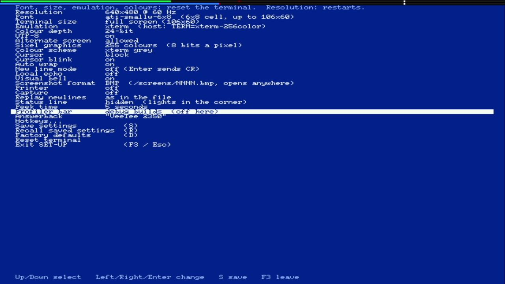

# 025 — ATI Small Wonder, a 72 Hz mode, and debug builds that show it

*2026-11-02*

Three requests from the user: debug builds should show the profiler
and other debug things by default; the RP2350 has a heatsink now, so
overclock a bit; and the default font should be the ATI "Little
Wonder".

## The font

The Ultimate Oldschool PC Font Pack (already the source of the FM Towns
fonts) has eight ATI fonts. Seven come from "ATI Wonder (and later)
video cards". The eighth, **ATI SmallW 6x8**, is from the *ATI Small
Wonder Graphics Solution*, the closest thing to a Little Wonder; the
user picked it. It's 6 pixels wide and 8 tall, so 640x480 holds **106
columns by 60 rows**. It's the first built-in font now
(`ati-smallw-6x8`) and the factory default.

## 6-pixel cells

Every fast path in the renderer was written for 8-pixel cells. Anything
else took the general path, a store per pixel. Measured first, at 6x8
on the old code: **16028 cycles a line**, twice the 8000 budget, with
core 1 starving tens of thousands of times a second. The picture would
have been in shreds.

A 6-pixel cell is three 2-pixel words. The glyph's bits are the top six
of its byte, so those three words are exactly the first three of an
8-pixel cell's expansion: the same mask table and the same PAIR table
(devlog 024) serve both widths. The span loops take the words per cell
as a constant, and each width gets its own compiled copy. Sixel tiles,
double-width lines and the status line got the same treatment.

| 6x8, 106x60, cycles a line (avg / worst) | General path | 6-px paths |
|---|---|---|
| Plain text | 16028 / 17144 | **3192** / 4195 |
| Every cell its own colours | 15891 / 16309 | 4725 / 4872 |
| Attributes everywhere | 16467 / 16987 | 5452 / 5626 |
| Double-width lines | — | 4781 / 4924 |
| Full-screen Sixel | 6982 / 12053, starving | 5176 / 7161 |

A host test checks each loop pixel for pixel against the glyph bits.
The tests that assumed the default font was 8x16 (80x30, 16-pixel rows)
now ask for `notjam-clean-16` by name.

## The overclock

On this board, overclocking isn't a knob. The PIO serialiser shifts one
TMDS bit per clock, so the system clock *is* the bit clock, 10x the
pixel clock, and every line is 8000 cycles at 640x480 however fast the
chip runs. A faster clock means a faster video mode. VESA's **640x480 @
72 Hz** (31.5 MHz, 832x520 total) puts the clock at 315 MHz instead of
252, exactly (12 MHz x 105 / 4), at 1.25 V.

| Measured, 400 KB of scrolling text | 60 Hz, 252 MHz | 72 Hz, 315 MHz |
|---|---|---|
| Throughput | 140 KB/s, 1772 lines/s | **174 KB/s, 2198 lines/s** (+24%) |
| Line budget | 8000 | 8320 |

The rendering costs per line don't move. What grows is the main loop:
parsing and scrolling run a quarter faster.

**But it's not the default.** The ShadowCast capture card shows nothing
at 640x480 @ 72: that timing is VESA-only, and HDMI capture devices tend
to take only the CEA list, where 640x480 exists at 60 Hz alone. The
board was fine; it answered over USB at 72 Hz, and switching back to 60
brought the picture straight back. A default that comes up black on the
user's own setup, after a factory reset or the crash fallback, would be
worse than no overclock. So 640x480 @ 72 Hz is in SET-UP's list, right
after 60 Hz, for screens that take it, and the default stays 60 Hz.

## Debug builds

A debug build is any with measurement compiled in (`build.h`: serial
stats, the render profile, the experiments). The boot banner now says
so, and the profiler bar comes up on:

With the 6x8 font, the bar's 8 scanlines cover the whole top text
row. That's fine for a debug build.

## Things that broke

**The debug build's profiler bar leaked into normal builds.** The first
version forced the setting on at boot in debug builds. Then a
resolution change in a debug build saved settings, and the forced value
went into flash with them. Flashed back to a normal build, the profiler
bar was still on. Now nothing is forced: the setting has three values,
off, on and **debug builds** (the default, on only in one), so a saved
record means the same thing in either kind of build. SET-UP says which
kind this is:

**The same code ran at two speeds.** Making the loops width-generic
first cost 8x16 text 18%: the PAIR copy stored three words, then loaded
and stored the fourth, which broke the block transfers. And `emit_cell`
interleaved its mask loads with its stores, another 5% on colourful
text. Putting both back in emit8's shape fixed that. The next build
then got 8x16 plain text back up from 2561 to 2987 cycles with that
loop untouched. That's the code-placement sensitivity devlog 022 ran
into: the loops run faster or slower depending on where they land
relative to instruction fetch. `-falign-loops=16` puts every loop head
on a 16-byte boundary. To test it, a single `nop` was put in front of
everything in `render_scanline`; the numbers stayed within 3 cycles
(2573 / 2574). That flag is in the base build flags now.

**640x480 @ 72 Hz, invisible.** As above. The capture card's black
frames are flat grey 7.0. A terminal screen, even an empty one, reads
2–4, so a script tells the two apart without anyone looking.

**The user's settings.** The board's saved settings, still a version
9 record, were rewritten along the way: by the resolution switches, by
the font change (ATI Small Wonder, saved), and by putting the profiler
bar to "debug builds" after the leak.
