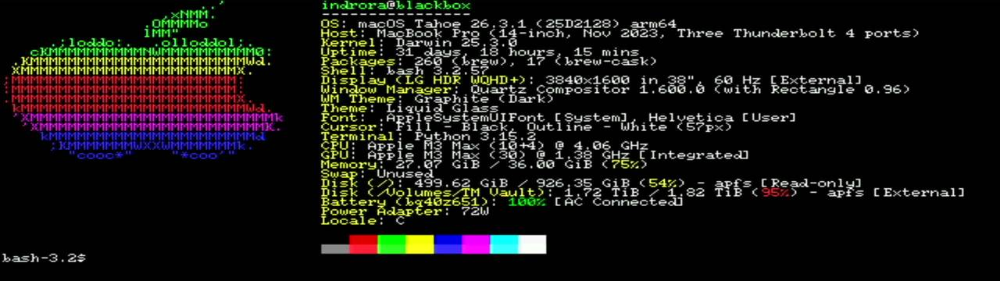
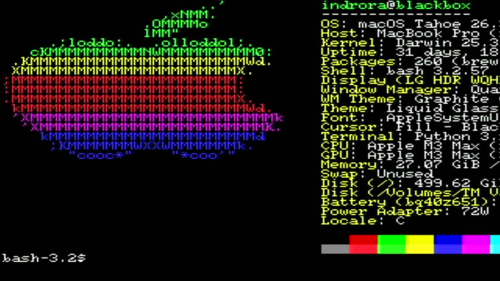

# 026 — fastfetch

*2026-11-02*

The user wanted to see fastfetch on it, so here it is. A real shell on
the Mac (`tools/hostshell.py`), its terminal the VeeTee over USB, then
`clear; fastfetch`. Nothing was staged for the picture. It shows the
pieces of the last few entries working together:

- **The font.** ATI Small Wonder 6x8 (devlog 025) puts 106 columns by
  60 rows on 640x480. fastfetch's logo and its info column fit side by
  side with half the screen to spare.
- **Colour.** The logo is drawn in six ANSI colours. The disk figures
  turn yellow and red as they fill. The palette bar shows the eight
  normal and eight bright colours.
- **The frame planner** (devlog 024). The logo's rows are mixed
  colours, so they're PLAIN spans. The blank rest of the screen is in
  the commonest pair, drawn from the preloaded table.

Up close, the logo in 6x8 cells:

One line of the output is wrong in a nice way: **Terminal: Python
3.15.2**. fastfetch identifies the terminal by walking up from its shell
to the first process that isn't one, and on the Mac that's
`hostshell.py`, the pty bridge. The terminal itself is on the other end
of a USB cable, where no process list can see it.
