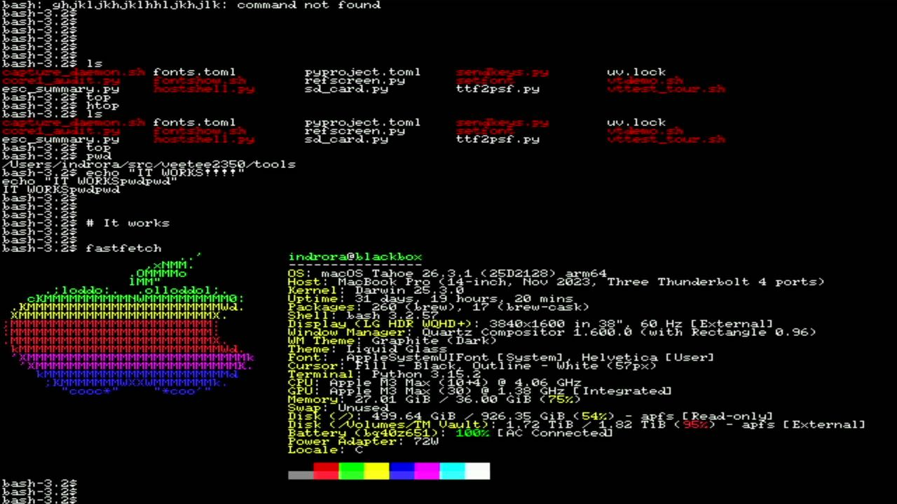
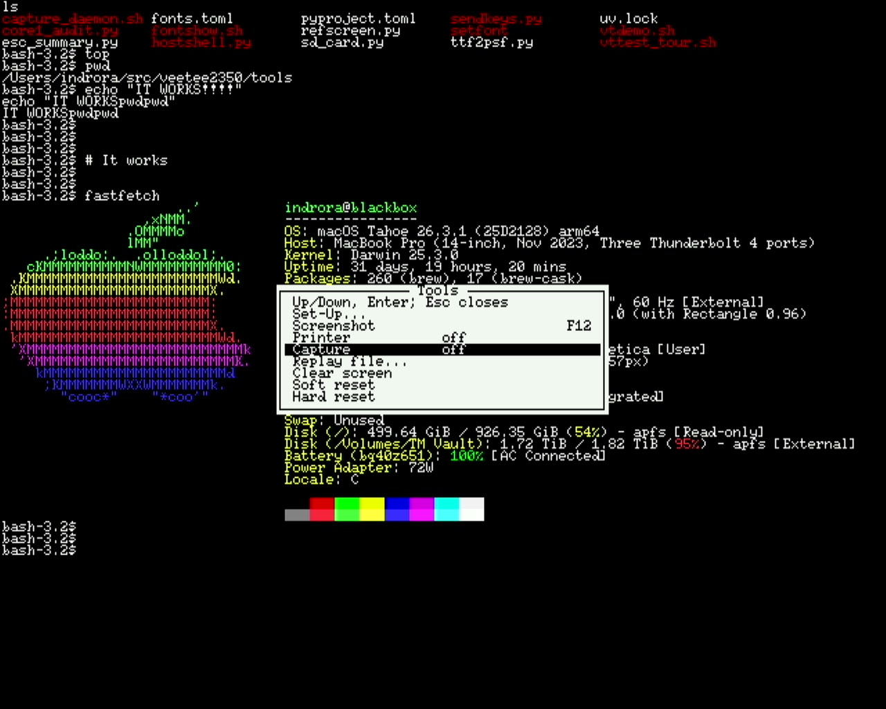
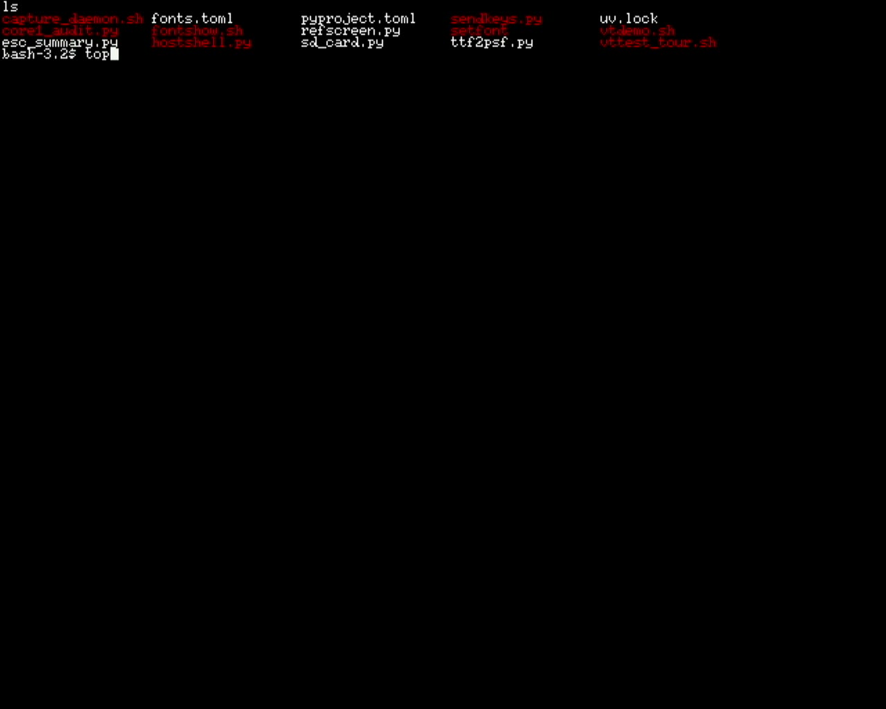

# 027 — A USB keyboard on the board itself

*2026-11-02*

Until now every key reached the VeeTee second-hand: typed into a
terminal on the Mac, which encoded it and sent the bytes down the
board's keyboard CDC port. That was Goal 3's "for now". This round the
board got a keyboard of its own, plugged into its second USB port. In
the picture above, everything was typed on it: home-row mashing, `ls`,
`top`, `htop`, `pwd`, and `fastfetch`. `echo "IT WORKS!!!!"` came out
as "IT WORKSpwdpwd", which is bash's history expansion (`!!` is the
last command, `pwd`) doing what it was told.

## The port

The RP2350-PiZero's second USB-C is a "PIO-USB" port: no USB controller
behind it, just GPIO 28 (D+) and 29 (D−), with USB done in software on
the PIO blocks. Waveshare's wiki doesn't give the pins. Their demo code
(the user put it in `external/upstream-demos`) and two other projects on
this board agreed on 28/29. Waveshare also says DVI and PIO-USB "cannot
be used at the same time"; the other projects do it, on different PIO
blocks, and so does this.

Three constraints shaped `lib/hal/usbhost.c`:

- **Timing.** The library runs each 1 ms USB frame from a timer
  interrupt and answers handshakes from the CPU within microseconds, so
  nothing may cut it off mid-packet. Its interrupt is now the only thing
  above the renderer's on core 0. The renderer's 8-line ring rides out
  the wait, and the picture shows nothing for it: 60 frames, no line
  ever late.
- **Clock.** It divides the system clock down to USB bit rates, so the
  clock has to be a multiple of 12 MHz. 252 MHz is (×21), so 640x480 @
  60 works, as do 960x540 and 720p30. In the 72 Hz mode (devlog 025) and
  the other in-between modes the port stays off, and the boot banner
  says why. *(Wrong: any clock works. Devlog 028.)*
- **Power.** The port's 5 V comes straight off the supply, with no
  switch.

## Keys

`lib/input/hidkbd.c` turns USB boot-protocol reports into the same key
events the CDC keyboard port produces. So Ctrl+F3, hotkeys, SET-UP and
replay take either kind without knowing which. A key counts when it's
new in a report: a repeated report does nothing. That matters on this
board, whose port keeps delivering a keyboard's last report after it's
unplugged. The decoder handles a US layout, the Caps / Num / Scroll Lock
keys and their LEDs, the keypad, and auto-repeat. USB keyboards leave
repeat to the host: here it's 500 ms, then 30 a second, as on a VT220.

What a key *sends* is the terminal's business now, because with a USB
keyboard the VeeTee is the terminal. libvterm has a keyboard encoder
that follows the terminal's modes, so `term_key_bytes()` uses it:
cursor keys change with DECCKM, the keypad with DECKPAM, Enter with new
line mode. A host test checks each against what xterm sends.

Checked on the board, from a log of what came up the serial line:
- Letters, a few hundred of them in fast rolls, none dropped or doubled.
- Shift (`!`, capitals) and Ctrl+C (`\x03`).
- Space, Backspace (`\x7f`) and Esc.
- F1–F4 as `ESC O P`–`S`, F5–F11 as `ESC [ 15 ~`–`23 ~`, and F12 as
  its hotkey.
- Print Screen and Pause sending nothing, so they're free for hotkeys.
- Auto-repeat at 30 a second.
- The arrows, and Ctrl+F3 for the Tools menu (below).

Every key this keyboard has worked. It has no Caps Lock or keypad, so
those paths (and the lock LEDs) are host-tested only.

## The whole thing, on tape

Afterwards the user recorded a run off the grabber (47 seconds, too big
for the repo). With the session above still on screen, Ctrl+F3 on the
USB keyboard opens the Tools menu, and the arrow keys walk it down
towards *Replay file…*:

Enter starts the replay of that session's capture file (devlog 023),
and the whole thing plays back off the SD card in about half a minute:
`ls`, `top`'s full screen and its redraw on quitting, the
`IT WORKSpwdpwd` gag, and fastfetch drawn again, matching what was
typed. Frames sampled every 3 seconds show nothing out of place.

## Things that broke

**Pico-PIO-USB.** Fetching upstream from GitHub was refused by Claude
Code's permission check as untrusted code, so the user chose to vendor
Waveshare's copy instead: **0.5.2**, older than the 0.7.2 another
project on this board runs. It needed three patches
(`lib/pico_pio_usb/PATCHES.md`):

1. **Three missing calls.** TinyUSB 3.7.7 calls three host functions
   0.5.2 didn't have yet: a frame number, closing an endpoint, aborting
   a transfer. Written from 0.5.2's own structures.
2. **Bus counters**, because the first flash found nothing. The port saw
   a full-speed device connected, but zero devices mounted.
3. **Separate PIO blocks.** The counters said: one connection, one
   reset, then four errors and not one successful transfer. The
   keyboard's first SETUP request never got through. Both halves were in
   PIO 1, and the transmit program's end-of-packet flag and the receive
   program's bit-stuff-error flag are *both PIO interrupt flag 1*. So
   every packet sent looked like a receive error. The library's default
   uses two blocks for that reason. DVI has PIO 0, so receive went to
   the RP2350's third block, which 0.5.2 didn't know about. With that,
   the keyboard (36b0:30e7) mounted.

**Brown-out on plug-in.** Plugging the keyboard into a running board
reset it: its inrush current pulls the unswitched 5 V down until the
chip's brown-out detector fires. Software can't stop that. Plug the
keyboard in first, use a powered hub, or (the real fix) add capacitance
or a load switch on the port. The boot banner now says why the chip last
reset, from the RP2350's latched reset flags, so a brown-out reads as
one: "last reset: brown-out (the supply dipped: a USB device plugged
in?)".

**One F12, two screenshots.** The key log showed it. The screenshot runs
inside the key's report handler and writes to the SD card for about a
second. TinyUSB only asks for the next report *after* the handler
returns, so the key-up couldn't arrive meanwhile. When the main loop
came back, auto-repeat found F12 still "held" and long overdue, and
fired again. Now the next report is asked for before a report is
handled, and a gap of over 100 ms between polls restarts the repeat
delay rather than firing it.

**The picture, gone again.** For much of this round the capture card
showed a flat "no signal" frame (grey 7.0) even while the user could
see the screen, which made "is it the board or the grabber?" a real
question several times. The answer was the grabber every time: a
Thunderbolt cable swap and a reset of the card fixed it. A debug build's
stats, 60 frames a second and nothing starved, settled it each time.

The instrumentation stays in debug builds: `[usb]` with the port state
and bus counters, `[hid]` with every report from every interface, and
`[key]` with where each key went (host, menu, hotkey, SET-UP).
