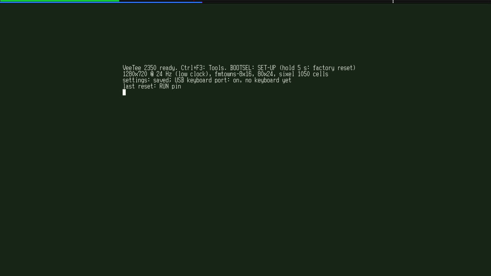
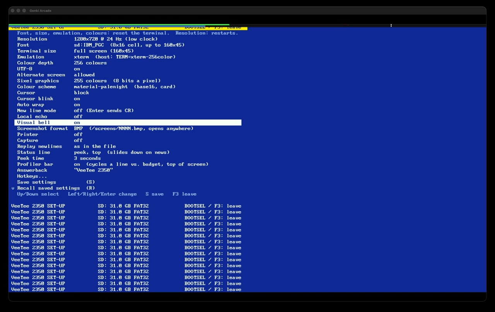
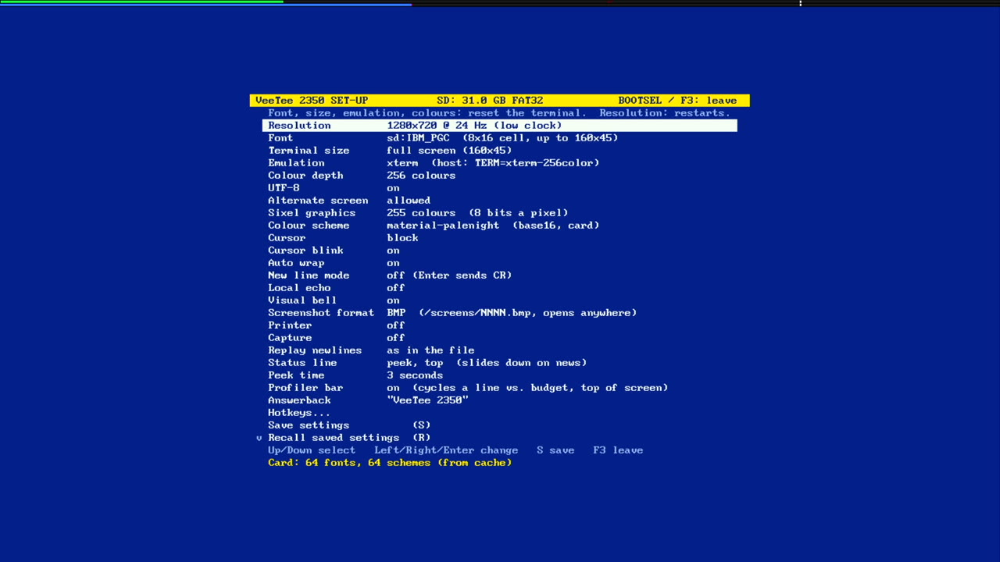

# 028 — A way out

*2026-11-02*

The user set the resolution to 1280x720 @ 24 (low clock) and then
couldn't change anything back. The board's USB keyboard was dead in that
mode, and the only keyboard left was a terminal on the Mac. Two
problems, then: there was no way out of a setting without a keyboard,
and a *setting* could switch the keyboard off. This round fixes both,
then the things that broke on the way.

## Hold BOOTSEL for a factory reset

BOOTSEL is the one input every VeeTee has. A tap already opened SET-UP.
Now **holding it for 5 seconds is a factory reset**:

- After a second, SET-UP opens and counts down in its message line:
  "Keep holding BOOTSEL: factory reset in 4 s". Letting go cancels.
- At 5 seconds every setting goes back to factory defaults and is saved.
  The board then waits for the button to be let go before restarting,
  because the bootrom reads BOOTSEL at reset and, finding it held, would
  come up as a USB drive rather than the VeeTee.
- It needs no keyboard and no picture, so it works blind, in a mode the
  monitor can't show.

A tap now counts on release, not on press. A press can't yet tell a tap
from the start of a hold, and a hold mustn't open SET-UP first. The
tap/hold logic is a small pure module (`lib/input/button.c`) with host
tests for taps, cancels, firing once, a main loop that was away (an SD
card scan) and the 49-day millisecond wrap.

On the board: the user held it at 720p24, and the VeeTee came back at
640x480 @ 60 on defaults.

## The USB keyboard in every mode

The keyboard port was off in five of the seven video modes, because
`usbhost_init` refused any system clock that isn't a multiple of 12 MHz.
Waveshare's demo says it should be, and devlog 027 repeated it.

It was never true. Pico-PIO-USB works out its PIO clock dividers from
the real clock, fractions allowed. A multiple of 12 MHz only makes the
*low-speed* dividers (sysclk / 6 and / 12 MHz) whole numbers. Full speed
was never whole, even at 252 MHz (/ 48 is 5.25, / 96 is 2.625), and it
worked there. A fractional divider moves an edge by at most one system
clock, about 3–4 ns, against 83 ns bits at full speed. The check is
gone.

The user then walked every mode with the USB keyboard itself: Ctrl+F3,
Enter, Right, F3 in each, typing the 72 Hz step blind since the capture
card can't show it. Every switch landed, so the keyboard works at 252,
315, 270, 295, 372 and 297 MHz. (720p30 is flaky on the ShadowCast, and
720p24 needed the card replugged once; both are the picture, not USB.)

### The red herring

On the way there, the debug line said the keyboard wasn't there:

![Debug build: "[usb] … no device … nak 66726" while [hid] reports and "[key] l -> host" scroll past](img/028-no-device.jpg)

Read the screen, not the summary line. `[hid] keyboard 00 00 0f …` is
the L key arriving, and `[key] l -> host` is it going to the shell. The
keyboard worked. The ~1000 NAKs a second, which Claude had taken for a
stalled enumeration, were just the board polling a keyboard with nothing
to say.

What *was* wrong was the status text. It counted devices from TinyUSB's
`tuh_mount_cb`, which fires only once **every** interface on a device is
set up. After a few warm restarts, with the keyboard powered throughout
(VBUS isn't switched), its typing interface came up but something else
on it never finished, so `tuh_mount_cb` never came. The banner would
have said "no keyboard yet" over a working keyboard. It now counts
mounted keyboards, and debug builds say "0 devices fully set up" instead
of "no device".

Also in that picture: bash is running the debug build's stats lines as
commands, because hostshell gives the shell whatever comes up the line
port. `[key] l -> host` even worked as a redirect, leaving empty files
named `host`, `menu` and `set-up` in the directory. Debug builds and
hostshell don't mix.

## SET-UP asks before leaving

The user's nit: F3 shouldn't save. It did, but only for a new
resolution, since that needs a restart, and a restart comes back on
whatever is saved. Now:

- **F4** (or the new *Save and exit* item) saves and leaves.
- **F3 / Esc** with nothing changed just leave. With changes they ask
  first, in the message line: "Save changes? Y: yes  N: discard  Esc:
  back", or "Save changes and restart? …" when the resolution changed.
- **Y** saves and applies, restarting into a new mode. **N** is "as if
  never here": nothing applied, nothing written, no restart.
- Leaving never saves by itself.

"Changed" is the user's two flags, *dirty* and *dirty reset*, worked out
rather than kept: the settings are compared against how they were when
SET-UP opened (or last saved). Changing something back clears them, and
R (recall) and D (defaults) count without special cases.
`settings_same()` compares text fields only up to their NUL, so the tail
of a longer, earlier font name doesn't make a record look changed.

## Things that broke

**SET-UP wouldn't open again.** After saving a change and leaving, it
wouldn't reopen, from the menu or from BOOTSEL, until a restart.
`enter_setup` allocated one terminal screen of cells for SET-UP's own
grid (57 KB at 160x45) and, if that failed, quietly returned. The memory
was there in total but not in one piece. A save that rebuilds the
terminal (font, size, colours) frees and reallocates big blocks at run
time, and the Sixel pool then takes "free heap minus a reserve", where
"free" counts the holes too. At boot everything is laid down in order,
which is why a restart fixed it. SET-UP is the way out of bad settings,
so it mustn't depend on the heap: it now has **19 KB of its own**, 80x30
cells at most. If it ever still can't open, it says so on the status
line. The bug was older than this round. It surfaced now because, with
N discarding, saving became the only way to apply anything.

**Then it wasn't centred:**

SET-UP's grid was switched in with `render_set_grid`, which only swaps a
pointer and is documented as being for "a different grid of the same
size". That was true until SET-UP got its own 80x30. The layout was
still the terminal's 160x45, so SET-UP sat top-left, and rows 30–44
pointed at row-map entries of 0, which is the title row. The way back
out had a quieter twin: the 160-column terminal grid swapped back in
under SET-UP's centred 80-column offsets, which could draw past the end
of a scanline until the next `render_init`. Both directions now pause
and lay out again:

## Loose ends

- **The Mac's keyboard port isn't passing keys through.** An `x` sent
  down `usbmodem…3` doesn't come back out of the line port, and Ctrl+F3
  doesn't open the menu. Scripted SET-UP tests relied on it, so it's
  next.
- **The keyboard's unfinished interface after warm restarts.** It's
  harmless, since typing works, but nobody knows what it is.
- **720p30** stays a mode some sinks won't lock to.
