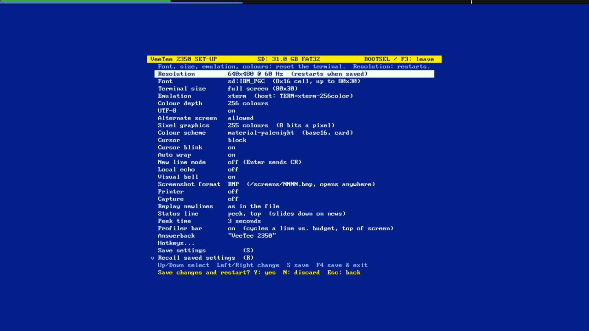
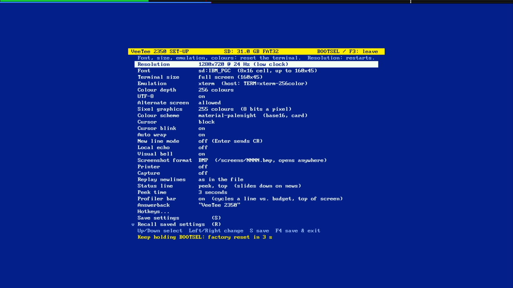
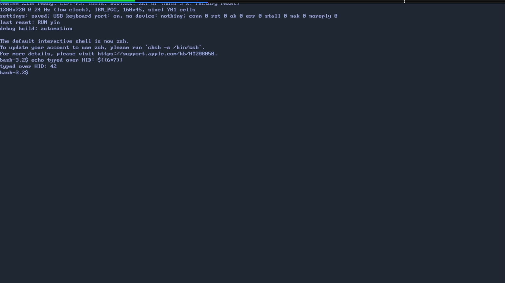

# 029 — Hands for the robot

*2026-11-02*

Nobody pressed a key to get that screen. A Python script on the Mac
opened the Tools menu, chose Set-Up, changed the resolution and pressed
F3, waiting after each step for the VeeTee to say where the key had gone.

## Why

Until the board had a keyboard, the VeeTee presented two CDC serial
ports: the line, and "VeeTee keyboard", whose bytes counted as typed
keys. That got the terminal going and let scripts drive it. Now the
board has a real USB keyboard (devlog 027), and the stand-in port had
quietly stopped passing keys (devlog 028). The user's call: swap it for
an HID endpoint built for automation, in debug builds only.

## The automation HID

Debug builds (`pio run -e pizero-debug`, or any debug env) now present
the line port and a vendor-defined HID, **VeeTee automation**: usage
page 0xFF00, one 64-byte report each way, no report IDs. That's
TinyUSB's generic in/out descriptor, which sidesteps the ways TinyUSB
and hidapi each treat report IDs. Byte 0 says what a report is
(`include/automation_hid.h`):

- **Keyboard**: an 8-byte boot keyboard report, decoded exactly as the
  real USB keyboard's are (`hidkbd.c`: layout, locks, auto-repeat), with
  a keyboard state of its own so it can't disturb a real one's held
  keys.
- **Typed bytes**: what an xterm sends for keys, `\x1b[1;5R` for
  Ctrl+F3, through the decoder the old keyboard port used. Old scripts
  keep their meaning.
- **BOOTSEL**: a button of its own, OR'd with the real one. Taps, holds,
  and the factory reset's countdown can be tested without a thumb:

- **Log** (in, VeeTee to Mac): the debug text. `[key] F3 -> set-up`,
  `[hid] …` and the stats used to go down the terminal's line. That's
  how bash ended up "running" `[key] l -> host` in devlog 028, leaving an
  empty file named `host` behind. Now the line carries only the terminal
  session.

Release builds have none of it: one CDC port, no HID. That was checked
by flashing both and listing the board's HID interfaces (none, then
0xFF00).

Each key goes into the same `handle_key` as a person's: hotkeys, the
Tools menu, SET-UP, the host. The decoding is a pure module
(`lib/input/automation.c`) with host tests. The firmware side is small:
on this port TinyUSB runs its device task in an interrupt, so OUT
reports are copied into a 32-slot ring there and the main loop takes
them. Log reports queue the other way and go out as the host takes them.
Nothing waits on a host that isn't listening; a full queue drops and
says so.

## The tools

`tools/vthid.py` mirrors the header over hidapi, the usual Python HID
library (`uv add hidapi`). `tools/sendkeys.py` runs steps on top of it:

    uv run sendkeys.py 'key:ctrl+F3' 'wait:-> hotkey' 'key:enter' \
        'wait:-> menu' 'key:right' 'key:F3' 'wait:F3 -> set-up'
    uv run sendkeys.py 'k:ls -G\r'   'keys:hello'   'tap'   'hold:4'
    uv run sendkeys.py --log

`wait:REGEX` is what makes a script reliable: it waits for the VeeTee's
own word that a key landed, rather than sleeping and hoping.
`hostshell.py --hid` sends the Mac's keys through the device, the way
`--keyboard` used to:

## Things that broke

- **A read that never came back.** cython-hidapi's `read(n, 0)` means
  "block until a report comes", not "don't wait", unless the device is
  set non-blocking. The first script hung right there.
- **A line that went missing.** `sendkeys` drains the log after every
  step so `--log` can echo it. That drain swallowed `[key] Ctrl+F3 ->
  hotkey` before the next `wait:` step looked for it, and the wait
  timed out on a key that had worked. `wait_for` now searches every line
  read since its last match, whoever read it.
- **A BOOTSEL that could stay down.** If a script died between `b:down`
  and `b:up`, the board would count to five and factory-reset the
  user's settings. Closing the device now always lets go first. (Only a
  `kill -9` gets past that.) The countdown test above held for 4
  seconds, not 5.
