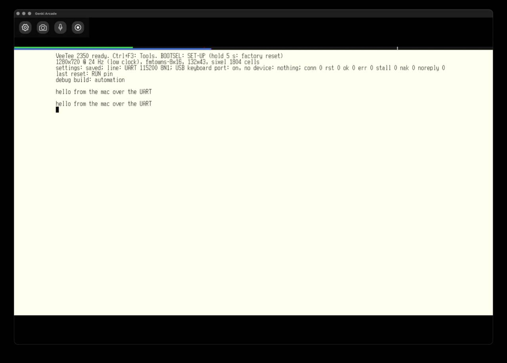

# 030 — A real serial line

*2026-11-03*

Until now the VeeTee's "line" was always the native USB's CDC port: a
serial port in name only, with no speed and no wires. This entry gives it
a real one. A USB-serial adapter sits on header pins 8 and 10, and the
text above came from the Mac down three wires at 115200 baud.

## The UART

The header's pins 8 and 10 are GPIO 4 and 5, which is UART1 on the
RP2350. Waveshare wired them to where a Raspberry Pi has its serial port
(docs/hat.md). Pins 31 and 26 (GPIO 6 and 7) carry CTS and RTS for
hardware flow control.

The driver (`lib/hal/serial.c`) is small, but it has two ideas in it:

- **Everything goes through rings.** The UART's FIFO holds 32 bytes,
  which is under 3 ms at 115200. The main loop can stop for much longer
  than that while an SD card write finishes. So an interrupt moves bytes
  from the FIFO into an 8 KiB ring, and sending works the same way in
  reverse.
- **RTS is driven by hand.** The PL011 has its own RTS, but it follows
  its FIFO, and the interrupt keeps the FIFO empty. Left to itself it
  would never tell the host to wait. So the driver raises RTS when the
  ring is 3/4 full, and drops it again below 1/4.

The rest of the firmware didn't change much: everything that talked to
`usbio_read/usbio_write(USBIO_LINE)` now goes through `line_read` and
`line_write`, and those pick the port.

## SET-UP, split up

SET-UP was one list of 30 lines. Adding six more for the serial line
would have made it scroll on every screen. So it's now what the VT420
and VT520 had: a **directory**.

- **Pages:** Display, Terminal, Communications, Printer and card,
  Hotkeys.
- **Actions:** save, recall, factory defaults, reset terminal, save and
  exit, exit.

Enter opens a page and Esc comes back. S, R, D, F3 and F4 work from
anywhere. The directory shows a summary next to each page, so
Communications reads "UART 115200 8N1" without opening it.

The **Communications** page has Port (USB or UART), Speed (300 to 115200),
Data bits, Parity, Stop bits and Flow control. The settings record is now
version 13, and a version 12 record upgrades into it on the USB line, so
nothing changes until someone picks the UART. A factory reset goes back
to USB as well.

## A poor man's getty

`tools/getty.py` puts a shell on the other end of the cable:

- it sets the port's speed and format;
- it sizes the pty from the VeeTee's resize reports, as hostshell.py
  does;
- it starts a new shell when the old one exits;
- it hangs the shell up on SIGTERM, SIGINT or SIGHUP.

The hang-up took two tries. On macOS a process closing its terminal waits
for that terminal's output to drain. The first version stopped reading
the pty, then waited for the shell. The shell sat half-exited, waiting
on getty, and getty waited on the shell. Now getty closes its end of the
pty first, and that close is the hang-up.

## Things that broke

- **A process `kill -9` can't touch.** `stty -f /dev/tty.usbserial-…`
  opens the port's `tty.` node, and on macOS that open waits for carrier
  detect. A bare USB-serial adapter never raises it. The `stty` hung in
  the kernel, and while it waited it also blocked the `cu.` node every
  later test needed. Only unplugging the adapter freed it. The lesson is
  to use `/dev/cu.*` for anything serial.
- **A test that looked at its own output.** The first "is the wiring
  right?" run ran while an earlier getty test still had the port open.
  What came back was zsh redrawing its prompt, not the VeeTee. The clean
  run got silence while idle, then exactly `hello from the veetee\r` when
  a line was typed through the automation HID. Both directions work on
  the first wiring.
