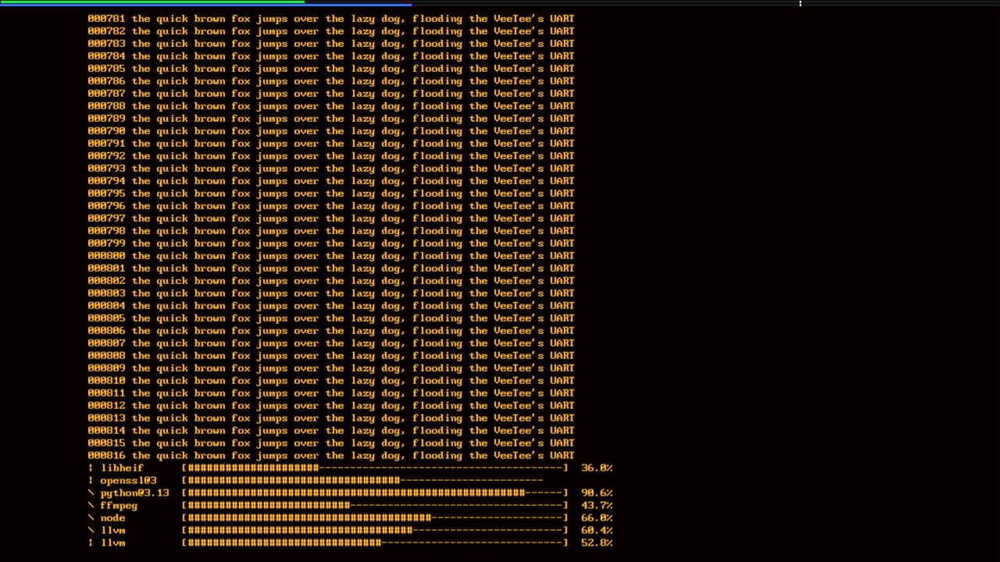

# 031 — Writing only in the blanking gap

*2026-11-03*

With a real serial line in place (devlog 030), `brew upgrade` over the
UART showed the VeeTee's worst habit: **tearing**. A progress bar
redraws itself in place many times a second. Some frames showed the top
of the screen from one moment and the bottom from the next, so a bar
flickered between two lengths. The frame budget was never in danger,
but it looked cheap.

## Why it tore

Two things share the screen's grid on core 0:

- **The render interrupt** reads the grid a few lines ahead of the beam
  and draws each scanline into an 8-line ring. Core 1 encodes those
  lines into TMDS.
- **The main loop** writes the grid as host bytes arrive.

The main loop wrote whenever bytes came in, so it often changed the grid
while the interrupt was halfway down the frame. The rows above the beam
showed the old text, and the rows below it showed the new.

## The gap

Real terminals had the same problem and the same answer: change the
screen during the vertical blanking interval, when nothing is drawn.
Here that interval is visible as a pause in the render interrupt. Once
the frame's last line is in the ring, it stops until the next frame
starts asking for lines.

A stats build timed every pause and kept the longest one each frame. It
always fell just before line **12**, and at 720p24 it lasted about
**511,600 cycles, or 1.7 ms**. The lead is 12 rather than 8 because
core 1 runs ahead too: on top of the 8-line ring, it holds 4 TMDS
buffers (`DVI_N_TMDS_BUFFERS`).

So `lib/hal/video.c` keeps the flag itself:

- `produce_lines` clears `in_gap` as it starts line 12 (`LEAD_LINES` =
  ring + TMDS buffers);
- it sets it again once the frame's last lead line is out.

`video_in_gap()` reads that flag. The cost is two compares per line in
`produce_lines`.

The first try put the check in a wrapper around `render_scanline`
instead. An A/B under the same load showed it cost 130–140 cycles a
line, about 2% of the render budget, just for a flag. STYLE.md says to
measure hot-path changes, and this is why: that version was reverted.

## Feeding

`feed_line()` in `src/app.c` now reads host bytes in 64-byte chunks,
only while `video_in_gap()` holds. It checks the flag again between
chunks, because the gap can end at any moment.

A flood has to stay safe, so there is an escape hatch. If more than
2 KiB is waiting, the loop may also feed up to 256 bytes mid-frame. One
torn frame is better than an overflowing ring. `serial_available()` and
`usbio_available()` let it see how much is waiting.

## Numbers

These come from a full 115200 8N1 flood (about 11.5 KB/s) at 720p24, in
a stats build, read over the automation HID. There were two loads: a
stream of plain lines, and six progress bars redrawn with cursor-up, CR
and erase-line, plus a spinner (the picture above).

| load  | fed in the gap   | fed mid-frame | most waiting | starved lines |
|-------|------------------|---------------|--------------|---------------|
| lines | ~11.5 KB / 24 fr | 0             | 64 B         | 0             |
| bars  | ~11.4 KB / 24 fr | 0             | 256 B        | 0             |

That is about 480 bytes a frame, all fed in the gap. The escape hatch
never opened. Render time was about 6,280 cycles a line against an
earlier baseline of 6,003. The baseline was taken with different
content on screen, and a screen packed with text costs more to draw.
The renderer itself didn't change in this commit.

## What's left

The capture shows the limit of this approach. The `openssl@3` bar is
half-redrawn: its end and its percentage are missing. Every frame now
shows a single moment of the grid, but the host doesn't write a whole
redraw in one go. A frame that lands between two parts of one redraw
still shows it unfinished. Fixing that would mean guessing where the
host's updates end (or honouring synchronized output, DEC mode 2026).
That is a separate feature.

The other idea from the tearing discussion is a row map latched once
per frame, with a spare row or two so a scroll never lands mid-frame. It
stays shelved until tearing shows up with a backlog building, which
these numbers say doesn't happen at 115200.
