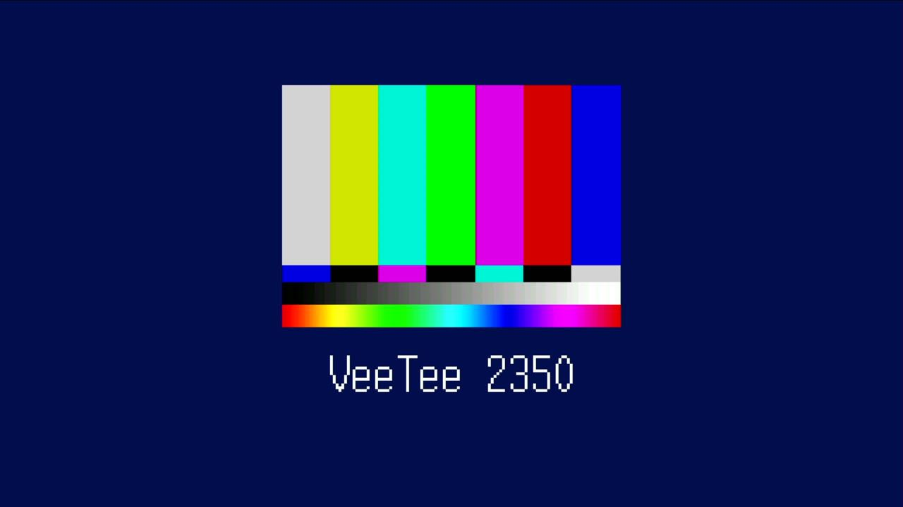

# 032 — A boot splash for the capture card

*2026-11-04*

On a fresh boot the ShadowCast capture card sometimes wouldn't lock onto
the picture. But tap BOOTSEL to bring up SET-UP and it locked every
time. The one obvious difference is the picture. A fresh boot is a black
screen with three lines of banner, while SET-UP fills most of the screen.
So the first three seconds now show a test card instead of the terminal.

## The card

`tools/splash.py --generate` draws it at 256x256. Inside a navy frame
it has seven 75% colour bars, the reversed strip from the SMPTE card, a
black-to-white ramp, a hue sweep, and the title in the FM Towns 8x16
font at twice its size. That gives the receiver hard vertical edges and
smooth gradients both.

The PNG it writes (`assets/splash.png`) is the source. Replace it with
any 256x256 image and run `uv run splash.py` again. That stores it as
RGB565 in `lib/render/splash_image.c`, exactly as the scanline wants it.
The image's **top-right pixel** sets the colour of the rest of the
screen, so a border can be one colour and the fill another.

## Straight from flash

The first version was a 16-colour 192x108 card, copied at boot into
SET-UP's idle screen buffer so the painter would read only RAM. Then
came the obvious point: the image is in flash already, and all it has to
do is get a few frames out to a capture card. So now the painter reads
it from flash directly. That's 128 KB of RGB565, with no palette and no
copy.

That breaks a rule the text renderer lives by: never touch flash from
the render IRQ. The image is 8x the XIP cache, so every image line is a
cache miss. But the sums allow it for this one job. A line at 1:1 is
512 bytes, and QSPI flash gives tens of MB/s, so a line costs a few
microseconds against 25–32 µs in every mode. And it lasts 3 seconds.

Going all the way to the DVI serialiser, with TMDS pre-encoded in flash,
doesn't work. TMDS is about 3.8 KB a line at 640x480, which would need
about 120 MB/s out of flash. That's more than QSPI can give, and every
mode would need its own copy.

## Painting it

`lib/render/splash.c` is a second scanline function, with the same shape
as `render_scanline`:

- a line above or below the card is a word fill;
- a line through it is a copy, two pixels per 32-bit load and store;
- at 720p each pixel fills a word (512x512); elsewhere it's 1:1.

Swapping it in and out costs the text renderer nothing:

- `video_set_scanline()` changes which function the render IRQ calls.
  The function and its argument are two stores, so the swap masks
  interrupts. The IRQ never sees the new function with the old argument.
- `render.live` stays false while the splash is up. `render_pause`
  waits for the renderer's frame counter to move, and it doesn't move
  while the splash draws. With `live` false, a pause returns at once
  instead of hanging.

Opening SET-UP ends the splash early. The terminal runs underneath the
whole time. The banner, host output and settings carry on as usual, and
they appear when the splash goes away. Nothing waits on it.

## Does it help?

The recording above was made by reflashing the board while ffmpeg
captured. The card locked partway through the 3 seconds, and the splash
was on screen for about the last 2, with no damaged lines from the flash
reads. One boot doesn't settle whether a busy picture makes the
ShadowCast lock faster. What tells us is cold boots in each mode.

Host tests: `test/test_splash` checks the layout at 640x480 and 720p,
that the card always starts on an even column, a background line, and
lines through the card at both scales, including its last line.
